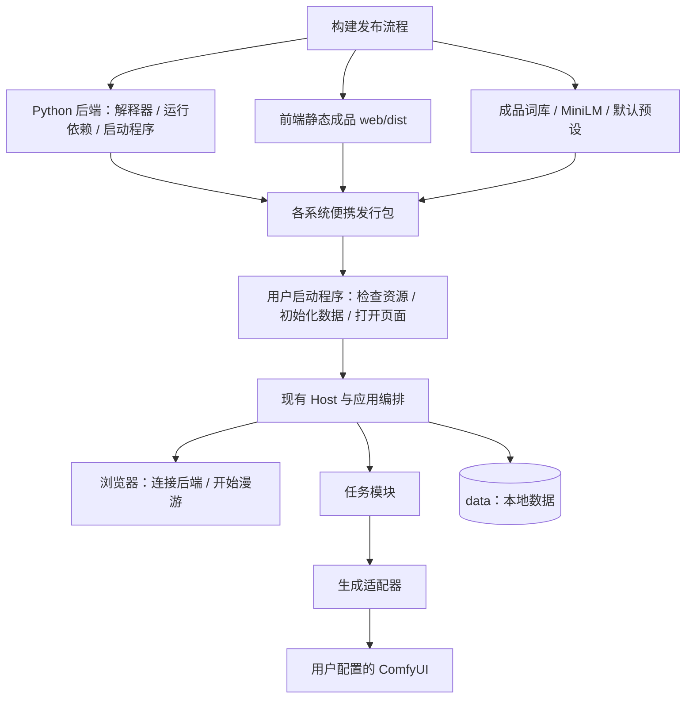
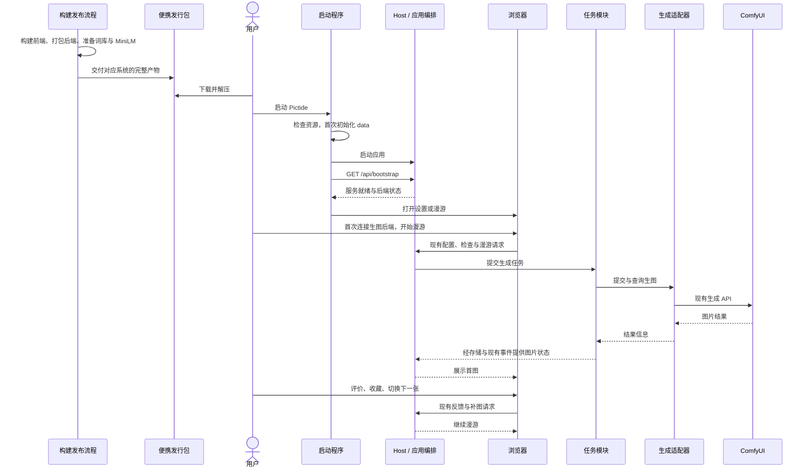

# 开箱即用的便携发行包

## 概述

让新用户以最少、最简单的操作完成第一次完整漫游：下载、解压、启动、连接生图后端，即可生成、浏览、评价并继续观看下一张。

发行方向已确认，打包与启动实现待完成；本设计以便携发行包交付已准备好的环境和资源，替代此前在用户启动时安装环境、构建前端和下载模型的方案。

## 架构

## 职责边界

- 构建发布负责安装开发依赖、构建前端、打包 Python 后端、准备词库和推荐模型、验证产物；用户收到可以直接运行的完整目录式压缩包。
- Python 后端优先采用 PyInstaller 目录式打包，将解释器、Python 包及原生依赖随程序交付；FastEmbed、ONNX Runtime、NumPy 和动态导入需在实际产物中验证。
- 前端以已构建的 `web/dist/` 随包提供。Node.js、pnpm、前端依赖安装和编译归属开发构建流程。
- 词库提供预处理成品；资源导出只包含 `tags/correlations/dataset` 及所需索引。MiniLM 提供当前编码器要求的固定版本 ONNX 和 tokenizer 文件；默认预设提供可以直接开始漫游的候选配置。
- 发行包的词库、模型和默认配置使用干净的种子资源；用户预设、图片、评价和偏好由各自实例保存。首次启动将所需资源初始化到所选 `data/`，后续启动沿用用户数据。
- 启动程序负责资源完整性检查、首次数据初始化、启动现有 Host、等待服务就绪并打开浏览器；资源异常显示原因和恢复操作。资源清单记录版本、文件大小和 SHA-256。
- 服务就绪与后端状态复用 `GET /api/bootstrap`。首次使用进入现有后端设置；保存连接后进入漫游，通过「开始漫游」生成首图。正常使用直接进入漫游。
- 生图能力由用户选择并连接的 ComfyUI 与文生图模型提供。发行包覆盖 Pictide 自身的完整运行资源，后端接入保持现有职责边界。
- Windows、Linux、macOS 按操作系统和 CPU 架构分别构建、验证和交付；用户指南提供各系统独立操作路径。
- 源码启动脚本继续服务开发与调试，环境准备步骤放在开发者路径。便携发行包的启动入口与资源定位在打包验证中落实，业务 HTTP 接口沿用现有契约。

## 调用和数据流

## 重点关注

- 验收以用户完成首次完整漫游为准：打开软件、连接后端、看到首图、喜欢或不喜欢、继续下一张，并在喜欢页查看收藏。
- 首次体验使用可靠的默认候选与漫游设置，专业参数留给后续调整；用户主要操作集中在启动、连接和浏览。
- 以仅具备受支持操作系统、浏览器及已就绪 ComfyUI 的干净机器验证发行包；确认运行所需的 Python、原生库、前端、词库和推荐模型均由产物提供。
- 对 Pictide 自身资源做离线启动冒烟，再使用已就绪 ComfyUI 验证完整漫游；保留版本、平台、产物体积和实际通过范围。
- 目录式打包优先便于启动、资源定位和排查问题；下载体积、解压占用和首图时间以实际产物测量，围绕整体上手成本优化。
- 程序依赖、模型、运行数据、缓存和日志遵循项目 `data/` 约定；已有用户数据继续保留，发行种子资源使用干净副本。
- 当前已实现的是源码启动路径。便携发行包的构建、平台验证与发布结果，在实现完成后同步到各系统用户指南。

参考：[PyInstaller 打包方式](https://pyinstaller.org/en/stable/operating-mode.html)、[平台构建要求](https://pyinstaller.org/en/stable/index.html)。
