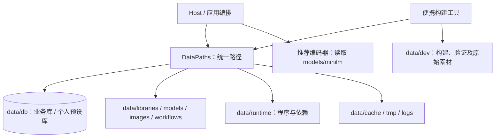
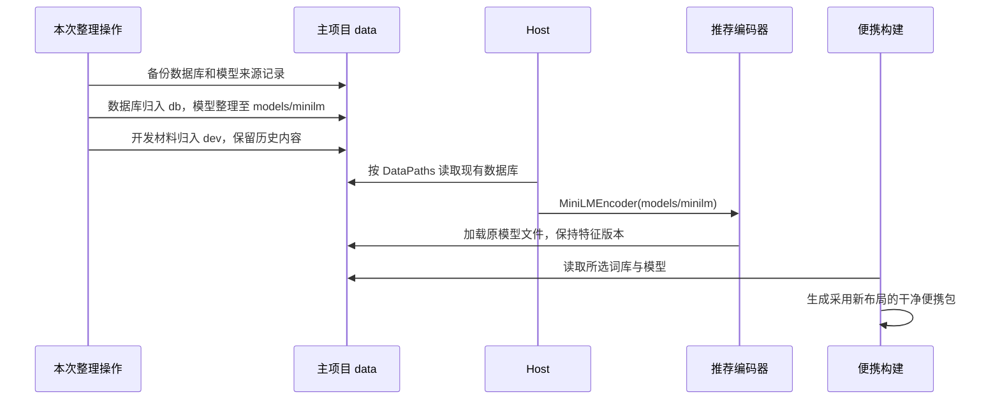

# 数据目录整理

## 概述

集中数据库、独立模型资源、归拢开发材料，让源码版和新便携包使用清晰一致的数据布局。

## 架构



## 职责边界

目标目录：

```text
data/
  db/                         pictide.sqlite3、candidate.sqlite3
  libraries/                  可选择的词库
  models/minilm/              model.onnx、tokenizer 及配套配置
  images/                    图片与提示词 JSON
  workflows/                 工作流
  history-cleanup.json        现有清理设置
  runtime/                   程序、运行环境与开发依赖
  cache/                     可重新生成的缓存
  tmp/                       临时文件
  logs/                      运行日志
  backups/                   数据备份
  dev/                       开发材料，普通便携用户无需管理
    datasets/                原始 Parquet 与离线导入中间文件
    releases/                便携发行产物
    verification/            验证实例与报告
    maintenance/             本机维护记录
    designs/                 设计素材
    previews/                历史截图
    legacy/                  退役目录材料
```

| 组成 | 变更接口与职责 |
| --- | --- |
| `DataPaths` | database / candidate_database 指向 db；新增 models、dev；ensure 只创建在线运行所需目录。词库、图片、工作流、运行环境及缓存路径保持。 |
| `MiniLMEncoder(model_dir)` | 直接读取 models/minilm 下的五个模型配置文件，移除 Hugging Face 缓存目录与 refs/snapshots 查找；向量计算和版本算法保持。 |
| Host / 便携构建 | 编码器使用统一模型路径；随包种子采用相同布局。构建参数和 HTTP 接口保持。 |
| 文档与开发输出 | 原始数据、发行产物、验证和维护材料归到 dev；各系统构建示例、数据指南和模型准备说明同步更新。 |

## 调用和数据流



## 重点关注

- 主项目整理前创建一致性数据库备份；模型文件内容保持，并核对整理前后的模型/特征版本，保留已有学习状态。
- 本次整理保留文件，历史内容仅移动归档；图片、喜欢、任务和个人预设保留。
- 已关闭的便携试用包随发行产物归入 dev/releases，包内个人数据整包保留；新构建的便携包采用新布局，主项目与试用实例的数据各自独立。
- 运行环境沿用现有位置，保留 Windows 虚拟环境中的路径；开发源码中的临时产物按实际用途归入 dev。
- 概念验证阶段采用本次一次性整理，程序直接使用新布局；通过少数路径、模型编码、预设及真实便携启动冒烟验证。

交付记录（2026-10-19）：

- 主项目数据库、模型与开发材料已归位；150 项移动/归档记录保存在 data/dev/maintenance/data-layout-20261019.json。
- 整理前备份位于 data/backups/before-data-layout-20261019-83bee0。数据库各表记录数保持，模型文件 SHA-256、模型/特征版本和中性文本编码结果与整理前一致。
- 路径、便携资源导出与个人配置保留、词库上传/选择/重启三项冒烟通过；真实 Windows 便携程序通过新数据库路径、平铺模型、离线编码和评分、移动目录及自定义数据目录验证。
- 新产物位于 data/dev/releases/portable-data-layout-20261019，ZIP 约 147.6 MiB；旧试用包及个人数据保留在 data/dev/releases/portable-compact-20261019。
- 验证记录位于 data/dev/verification/data-layout-20261019。验证实例已停止，真实 GPU 生图和 Linux/macOS 原生运行未执行。
