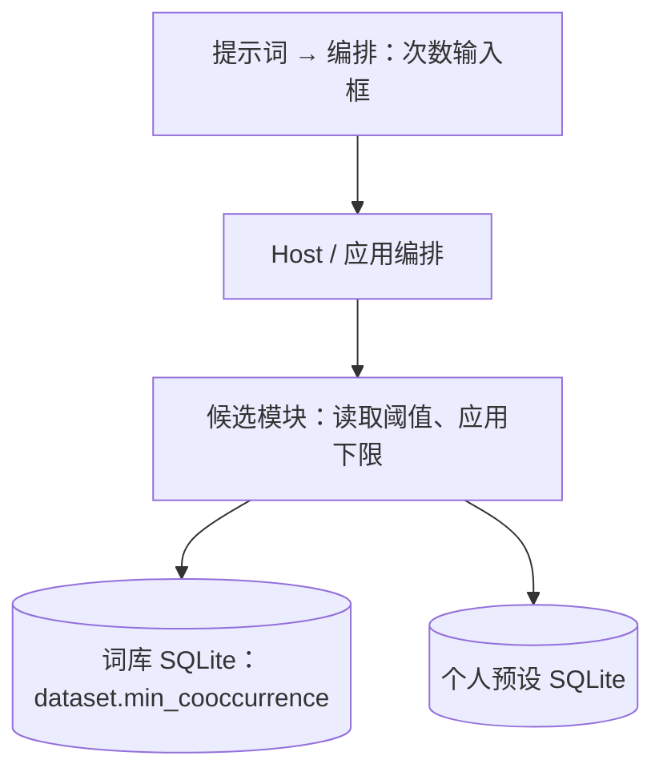
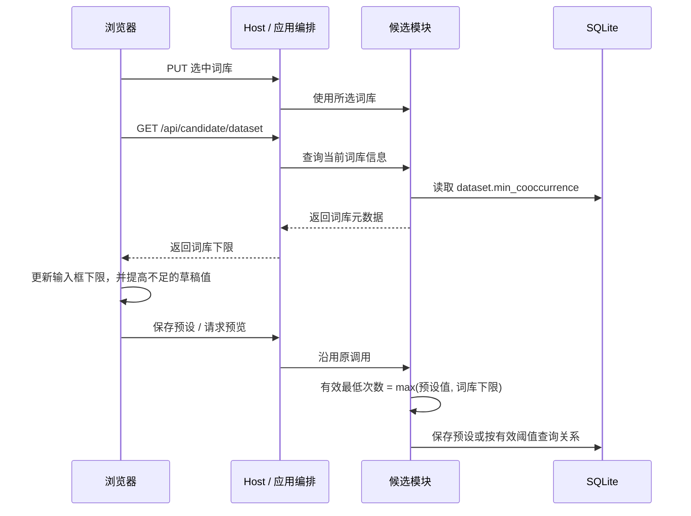

# 词库最低共现次数约束

## 概述

词库保存最低共现次数，编排中的「最低共现次数」以所选词库的值作为下限。

## 架构

## 职责边界

| 组成 | 变更 |
| --- | --- |
| 词库 SQLite | dataset 新增 min_cooccurrence 正整数，表示加工时保留关系的最低共现次数；基础导入写入 10，精简库写入 1000。 |
| 导入、上传与便携构建 | 导入时写入、上传校验并保留、发行导出时保留该字段，阈值随词库文件携带。 |
| 候选模块 / Host / 应用编排 | 沿用现有接口，GET /api/candidate/dataset 返回 min_cooccurrence；预设保存与生成使用 max(预设值, 词库下限)。 |
| 浏览器编排页面 | 初次加载、加载预设和切换词库时更新输入框 min；当前草稿数值低于下限时自动提高，较高值保持。悬浮提示显示当前词库下限。 |

词库 GET/POST/PUT、预设和生成请求路径保持。当前本地两份词库先备份，再分别写入 10、1000；新便携包随带具有该字段的精简词库。

## 调用和数据流

## 重点关注

- 下限 1000 时，当前值 10 自动提高到 1000，当前值 1500 保持；改选下限 10 的词库后，输入框允许更低值，当前较高数值保留。
- 自动调整只修改当前草稿，点击保存才写入个人预设；已有预设批量保持原值，生成时统一使用有效下限。
- 阈值来自词库明确记录的加工参数；页面刷新时直接读取元数据。
- 界面与后端共用同一限制；普通预览、手动生成和漫游均沿用候选模块的约束入口。
- 少量验证覆盖阈值随文件上传保留、切库升降下限、较高值保留及生成使用有效值。

实施记录（2026-10-19）：

- 两份本地词库已备份至 data/backups/before-library-floor-20261019，分别写入 10、1000；标签与关系记录数保持。
- 新增预设、保存及所有候选生成入口按所选词库应用有效下限；加载和切库保留已存预设原值，页面草稿独立调整。
- 词库上传/切换/保存/预览与完整组合池生成两项集成冒烟通过；离线 Parquet 导入冒烟确认输出元数据为 10。核对记录位于 dev/verification/library-floor-20261019。
