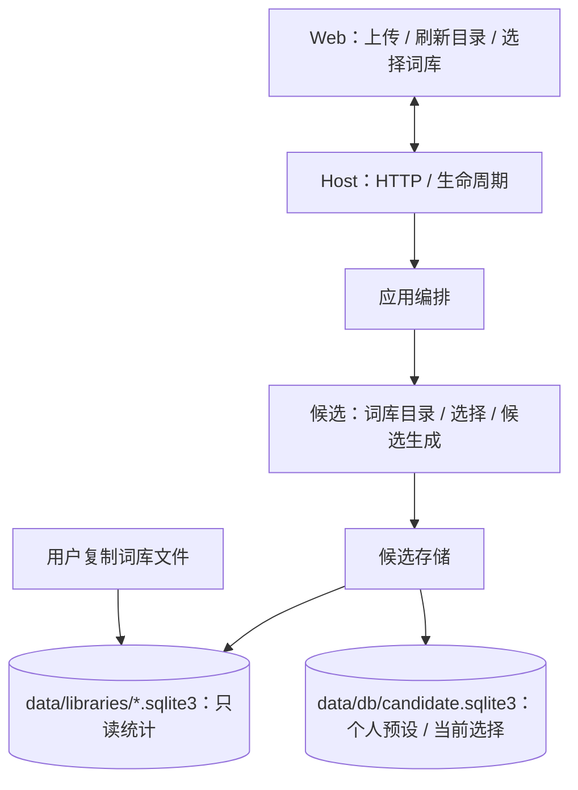
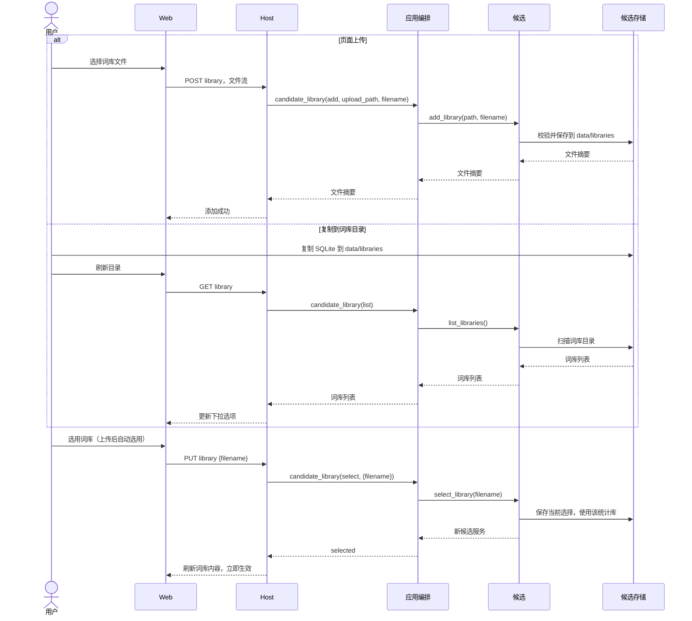

# 词库上传与选择

## 概述

词库统一存放在专用目录，用户通过上传或复制文件添加，并在页面选择后立即使用。

按用户确认的目录与选择方案实施；便携打包另见[便携发行计划](automatic-startup.md)。

## 架构

## 职责边界

**词库目录与个人配置**

- `data/libraries/` 专门存放可选词库 SQLite 文件。用户可以从页面上传 `.sqlite3` / `.sqlite3.gz`，上传时校验并将解压后的 SQLite 保存到此目录；也可直接复制 `.sqlite3` 文件到此目录，点击刷新后选择。
- 个人固定词与预设、当前词库选择保存在 `data/db/candidate.sqlite3`。选择另一词库只切换统计来源；导入文件中的预设继续由用户本地预设替代。图片、锚点和偏好沿用现有业务存储。
- 本项目现有混合数据库在集成时先备份，再一次性整理为词库文件与个人配置文件；运行实现使用这套目录布局。
- 新文件采用可区分的文件名；上传同名文件自动添加编号，已选词库继续可用。初次发行的默认词库可与用户添加的精简版、完整版本并存。

**HTTP 与模块接口**

| 接口 | 输入 | 作用与输出 |
| --- | --- | --- |
| `GET /api/candidate/library` | 无 | 刷新目录列表，返回 `{selected, libraries:[{filename,tag_count,relation_count,bytes}]}` |
| `POST /api/candidate/library` | multipart/form-data，字段 `file` | 校验并保存词库，返回 `{filename,tag_count,relation_count,bytes}` |
| `PUT /api/candidate/library` | JSON `{filename}` | 选择该词库并立即生效，返回 `{selected}` |

- Host 负责文件上传与同源检查，只有该 POST 接口接收 multipart；临时文件放在 `data/tmp/`，上传及 gzip 解压上限各为 2 GiB。
- App 新增 `candidate_library(action, payload=None, upload_path=None, filename=None)`，协调列表、上传和选择；选择后切换候选服务并发布候选状态事件。
- Candidate 提供 `list_libraries()`、`add_library(path, filename)` 和 `select_library(filename)`；列表只读取有效的候选统计库，校验和文件读写通过候选存储适配器完成。
- 选择时重新建立候选服务与缓存，新请求使用所选库；已有任务和预取图片沿用既有快照。推荐与任务模块通过 App 继续协作。
- 词库切换后，已有固定词继续按文本匹配所选词库；匹配到的参与统计，其他词保留完整输出。

**界面**

- 「提示词 → 词库」提供当前词库下拉选择、上传按钮与刷新按钮；选择后直接刷新词库内容。
- 上传成功后将新文件加入下拉列表并选用，用户手动复制文件则刷新后选择。个人预设编辑草稿保持。
- 复用 shadcn Select、图标按钮和现有按钮反馈，支持简体中文与英文；目录位置通过帮助提示展示。

## 调用和数据流

## 重点关注

- 用户只需上传或复制文件，再选择词库；同一目录可以保留多个版本随时切换。
- 词库统计与个人配置分开保存，避免更换词库影响用户预设。
- 少数冒烟覆盖 SQLite/gzip 上传、复制后刷新选择、即时生效、重启保留选择、同名文件与异常文件提示。
- 已通过：SQLite/gzip 上传、目录新增后刷新选择、即时切换、重启保留、预设保留、异常文件与所选文件替换的 HTTP 冒烟；前端类型检查和构建；真实浏览器上传、跨客户端刷新、草稿保留和 390px 窄屏布局。
- 验证采用中性词库与模拟后端，记录位于 `data/dev/verification/library-selection-20261019/`。集成前备份混合库与前端，统计和个人预设分开保存。
