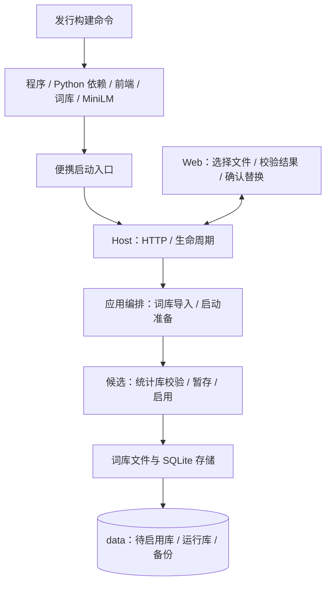
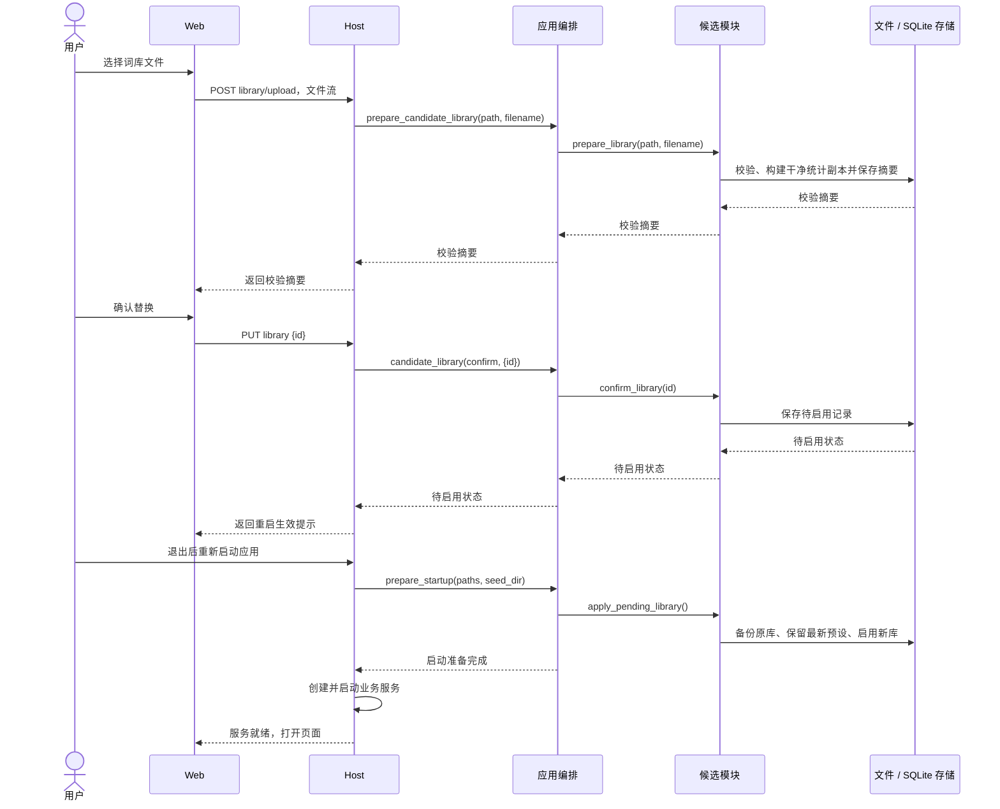

# 便携发行与词库替换实施接口

## 概述

将已确认的便携发行方向落实为可构建、可启动的产物，并提供词库文件导入、确认与重启启用流程；以下新增接口待确认后实施。

## 架构

## 职责边界

**发行构建与启动**

- 新增构建入口 `python -m backend.release --source-data-dir PATH --output-dir PATH`：从已准备的本机资源构建目录式发行包，再压缩成对应系统和架构的文件。前端使用已构建的 `web/dist`，词库导出干净统计数据，MiniLM 使用当前固定版本文件；个人任务、图片、偏好、后端密钥和预设由各自实例保存。
- 使用 PyInstaller 打包解释器、后端、Python 与原生依赖；程序依赖放在发行目录的 `data/runtime/`，前端和初始化种子资源随程序提供。用户的运行词库、模型缓存和业务数据沿用所选 `data/`。
- 便携启动程序支持 `--port PORT`、`--data-dir PATH`、`--lan` 与验证用的 `--no-browser`。发行包按系统提供一个启动入口；程序就绪后自动打开页面。源码启动入口继续可用。
- 初始化只补齐首次运行所需资源；用户已有词库与数据继续使用。Windows 在本机生成并验证真实产物；Linux/macOS 提供本机构建路径，原生验证结果分别记录。
- `Host.create_app(..., seed_dir=None)` 可接收发行种子目录；新增 `PictideApplication.prepare_startup(paths, seed_dir=None)`，在候选和任务服务实例化前协调资源初始化及待启用词库生效。源码启动同样启用已确认的待替换库。

**词库上传与确认**

| HTTP 接口 | 输入 | 输出与作用 |
| --- | --- | --- |
| `POST /api/candidate/library/upload` | multipart/form-data，`file` 为 `.sqlite3` 或 `.sqlite3.gz` | 校验并暂存，返回 `{id,filename,tag_count,relation_count,bytes}`；此时运行库保持 |
| `PUT /api/candidate/library` | JSON `{id}` | 将该上传标记为待启用，返回 `{pending:摘要,restart_required:true}` |
| `GET /api/candidate/library` | 无 | `{pending:摘要或null}`，刷新页面后仍能查看待替换状态 |
| `DELETE /api/candidate/library` | JSON `{}` | 取消待启用替换，返回 `{pending:null,restart_required:false}` |

- Host 负责文件流、请求大小与来源检查，临时文件写入 `data/tmp/`；仅该上传接口接收 multipart，其余修改接口沿用 JSON 与同源检查。
- App 新增 `prepare_candidate_library(path, filename)` 与 `candidate_library(action, payload=None)`，统一调用候选模块并发布候选状态事件。
- Candidate 对外新增 `prepare_library(path, filename)`、`confirm_library(id)`、`pending_library()`、`cancel_library()` 和启动用的 `apply_pending_library()`；校验、文件处理与 SQLite 操作使用存储适配器。
- 上传校验当前 SQLite 结构、完整性、来源状态、有效标签与关系。接收的统计表为 `tags/correlations/dataset`；导入文件中的个人预设由本地预设替代。上传及 gzip 解压大小各限制为 2 GiB。
- 校验摘要、确认状态和待启用记录持久化为 `data/` 下的 SQLite 数据。一次保留一个确认后的待启用库；后续确认新的文件替代上一项。

**重启启用与界面**

- 启动阶段先备份原词库，再把本地最新 `presets` 写入已校验的新库，关闭 SQLite 句柄后替换 `data/candidate.sqlite3`。候选服务随后从新库启动，序列和查询缓存重新创建。
- 已有图片、观看位置、锚点、偏好和任务快照沿用；已经提交的任务按现有恢复逻辑继续，已有预取图片保留。新候选使用新词库。
- 「提示词 → 词库」搜索栏旁提供替换按钮，选择文件后展示校验摘要并确认；成功显示“重启后生效”，提供取消待替换操作。复用 shadcn 组件与中英文翻译，实际重启仍由用户操作启动程序完成。
- 当前已有的基础业务与推荐接口继续沿用；这次新增的是发行、词库导入和启动准备入口。

## 调用和数据流

## 重点关注

- 以依赖齐备、服务启动、页面与词库可用、推荐模型可执行为发行验收重点。用户连接已就绪的生图后端后，具备完整漫游条件。
- 第一版验证少数主要路径：SQLite/gzip 导入、确认后重启启用、确认后编辑预设仍保留、取消替换、异常文件提示；使用独立数据与端口。
- 真实 Windows 发行包从解压目录启动，使用随包解释器和依赖，检查前端、候选及推荐资源；记录体积和就绪耗时。
- 数据与原始素材先备份；当前运行库与图片在确认启用前保持。词库校验和解压在线程执行，上传暂存阶段沿用现有任务处理。
