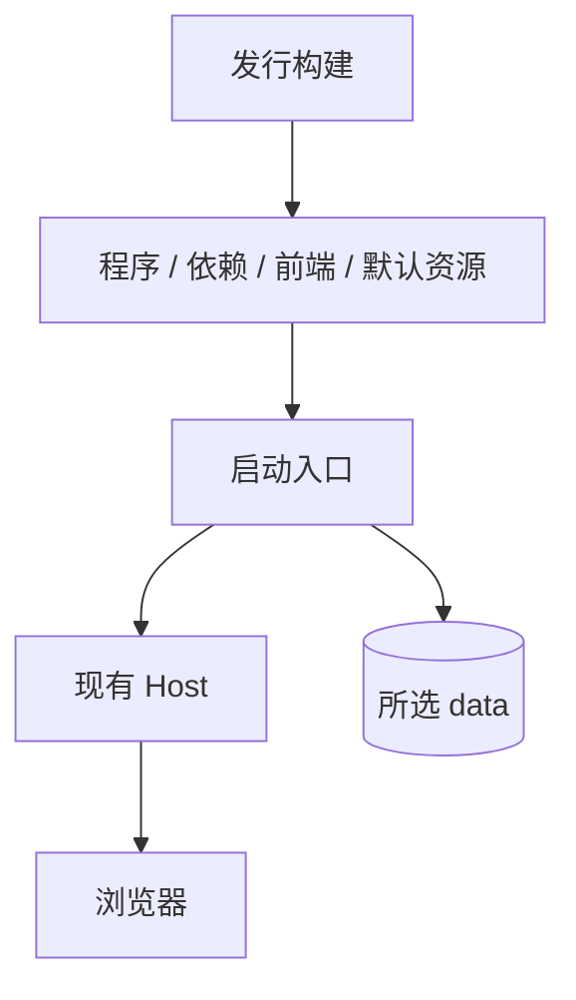
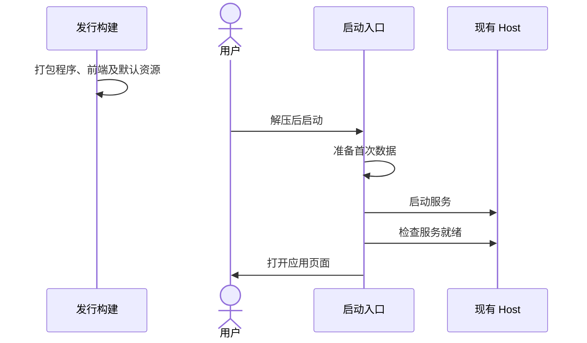

# 便携发行实施计划

## 概述

将程序、运行依赖、前端、默认词库和 MiniLM 一起交付，让用户解压启动后具备漫游条件。

本项待实施；词库上传与选择已独立完成，见[词库管理](library-selection.md)。

## 架构

## 职责边界

- 发行构建使用 PyInstaller 目录式打包，准备各系统程序、已构建前端与固定版本默认资源。
- 启动入口检查资源、初始化首次数据、启动现有 Host，并在就绪后打开页面。
- 词库文件与个人数据沿用[当前布局](../data-layout.md)，后续启动沿用用户选择。
- 具体构建和初始化接口在本需求实施前提交确认。

## 调用和数据流

## 重点关注

- Windows 优先验证真实产物，Linux/macOS 分别本机构建并记录验证结果。
- 记录下载体积、解压占用与就绪耗时；首次后端配置沿用现有设置。
- 本项设计与词库管理分别维护，完整目标见[便携发行目标](automatic-startup.md)。
