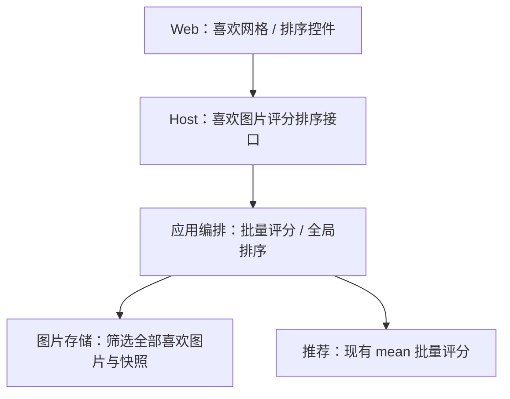
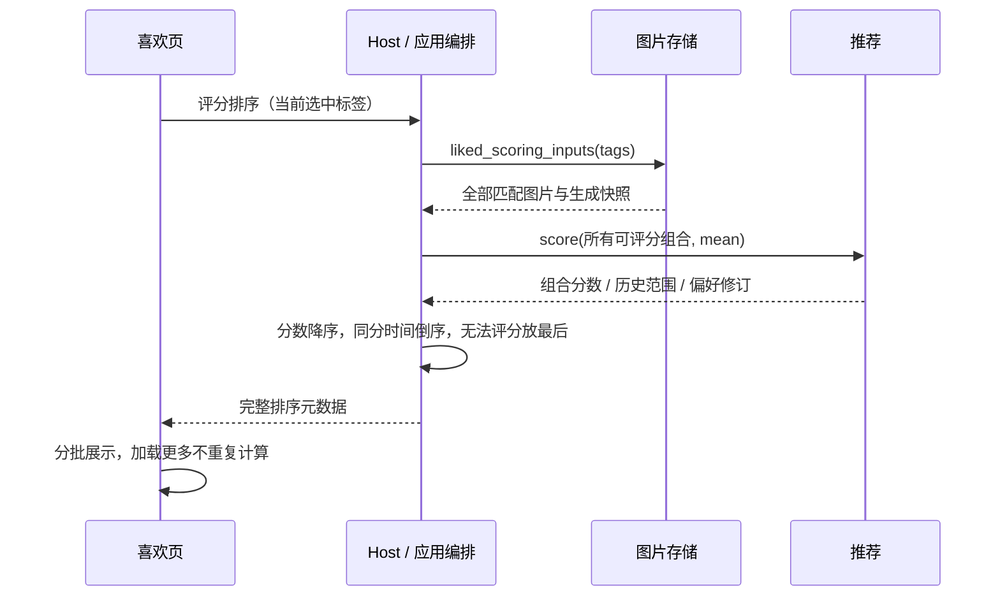

# 喜欢页按偏好评分排序

## 概述

喜欢页新增按当前偏好评分从高到低排序，继续支持多标签筛选。

## 架构

## 职责边界

| 组成 | 变更与接口 |
| --- | --- |
| Web | 喜欢页增加“最新优先／偏好评分”选择，默认最新优先；评分模式提供刷新按钮。接收全部排序元数据，每批展示 15 张，复用现有加载更多和大图导航。排序选择只保留在当前页面会话。 |
| Host / 编排 | 新增 GET /api/liked/ranked，可重复传 tag 参数。编排获取所有符合筛选的喜欢图片，使用同一请求、同一偏好参数批量评分，排好序再返回。 |
| 图片存储 | 新增 liked_scoring_inputs(tags=())，一次读取筛选后的全部喜欢图片及其生成词项快照，不受当前加载数量限制。 |
| 推荐 | 复用 score(ScoreRequest(strategy=mean))，即强力推荐内部采用的确定性评分策略；产品层 strong 还包含候选数量倍增，此处只给已有图片排序，不涉及该生成设置。不新增推荐接口，不引入探索，不触发学习。历史最高最低分按现有评分逻辑更新。 |

接口返回 artifacts（完整排序的图片元数据列表）、revision（图片状态修订）、state_revision（偏好状态修订）、score_min、score_max、scoring_available、error。图片元数据沿用现有结构，不返回图像二进制；前端按返回顺序逐批呈现。无完整快照的图片同样保留在结果中。

## 调用和数据流

## 重点关注

- 按原始确定性分数排序；同一次响应内的 0–100 换算是单调变换，顺序相同，避免显示位数造成错误并列。
- 同分按生成时间倒序、图片 ID 倒序；没有快照的图片放最后，其内部仍按时间倒序。推荐不可用时保留所有图片、按时间展示，并提示无法按偏好评分。
- 进入评分排序、改变标签筛选或点击刷新时重新批量评分；浏览期间保留本次顺序，普通任务事件不触发整库重算或重排。
- 本页取消喜欢立即移除；其他页面／设备新增喜欢及偏好学习变化，在重新进入、改变筛选或刷新排序后生效。
- 图片信息面板仍按原逻辑打开时重算，可能反映比当前排序快照更新的偏好状态。
- 最新优先沿用已有分页；评分排序一次获取完整元数据、前端逐批加载，不新增数据库表、持久排序缓存或后台任务。
- 确定性评分缓存已求出的偏好权重，同一用户、特征版本和学习／重置修订未变化时不重复求解。偏好更新、重置或模型变化时失效，下次使用前重建；新增未学习标签的具体权重为零。
- 相同生成词项组合先去重、评分后映射回图片；推荐内部按小批构造特征并点积，整次请求共用同一偏好快照，避免建立“所有图片 × 全部标签”的大矩阵。Thompson 探索逻辑保持原行为。
- 图片很多时显示加载状态；实现后记录当前本机词库和喜欢图片规模的实际耗时，不承诺任意规模下的速度。

状态：用户已授权完善设计并实施，补充缓存权重、组合去重和分批点积的内部优化。