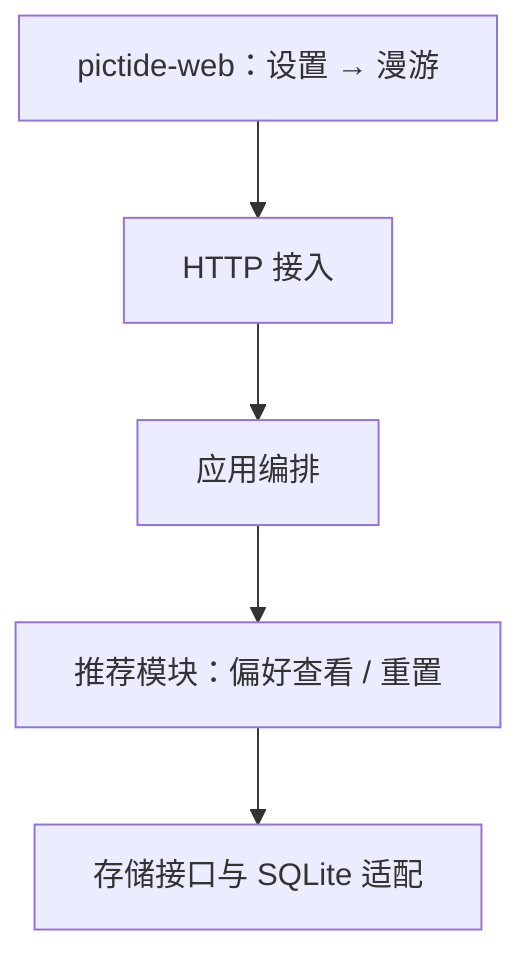
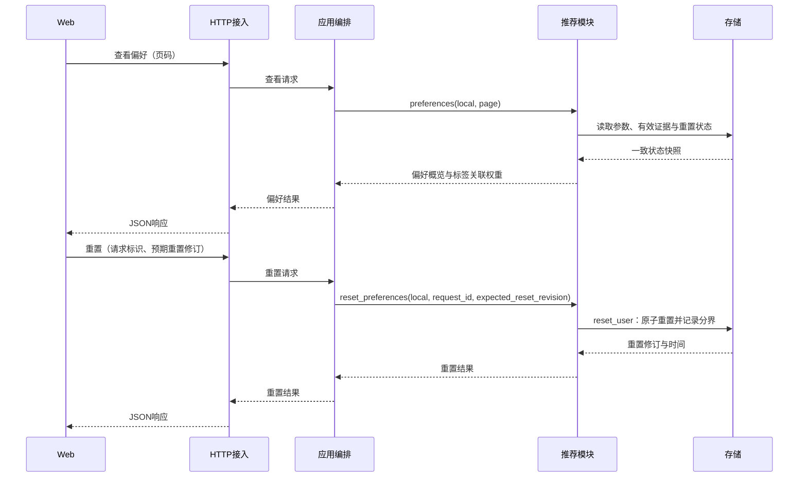

# 用户偏好查看与重置

状态：设计已确认并实现。确认范围为架构、跨模块调用与数据流、模块对外接口。界面与内部实现沿用现有规范；既定边界不重复确认。

## 1. 架构

复用现有模块，不新增业务模块：

箭头表示调用依赖。Web 展示和发起请求；Host 转换请求与响应；App 确定当前用户并协调调用；推荐模块解释偏好与执行重置用例；Store 持久化状态并保证事务一致性。

## 2. 模块调用与数据流

查看只读取已学习结果，不触发随机采样、学习或生图。推荐根据后验中心计算具体标签的关联权重，并结合有效证据返回列表；权重不是喜欢概率，负值表示负向关联，不等于对这个标签的独立厌恶判定，管理类目不参与。

重置当前用户全部推荐版本的参数与学习证据，保留图片、任务、喜欢/不喜欢标记、标签库、规则、模型与向量缓存。Store 在同一事务记录反馈事件分界、清除学习状态、保存幂等结果；后续通知重放、历史反馈导入和版本迁移都遵守分界，避免恢复旧偏好。在途旧学习提交须被拒绝，重置后产生的新反馈继续学习。图片反馈保持原状态，撤回后再评价才重新作为新证据；重置不取消已提交任务或已完成评分。

## 3. 模块接口

### HTTP：Web ↔ Host ↔ App

| 接口 | 输入 | 输出 |
| --- | --- | --- |
| `GET /api/recommendation/preferences` | `page`，默认1，每页15条 | `PreferencesResult` |
| `POST /api/recommendation/preferences/reset` | `request_id`、`expected_reset_revision` | `ResetResult` |

App 使用现有用户 `local`，不接受客户端指定其他用户。非法输入返回400，重置修订冲突返回409；相同重置请求重试返回原结果，不再次清除新积累的偏好。模型不可用通过可用状态及原因表达，重置操作不依赖编码器可用。

### App ↔ 推荐模块

| 新增接口 | 输入 | 输出 |
| --- | --- | --- |
| `preferences(user_id, page=1)` | 当前用户、页码 | `PreferencesResult` |
| `reset_preferences(user_id, request_id, expected_reset_revision)` | 当前用户、幂等请求标识、预期重置修订 | `ResetResult` |

已有 `score`、`apply_feedback`、`status` 的签名保持。

### 推荐模块 ↔ 存储

| 新增接口 | 输入 | 输出 |
| --- | --- | --- |
| `get_reset_state(user_id)` | 当前用户 | `ResetState` |
| `reset_user(user_id, request_id, expected_reset_revision)` | 用户、幂等请求标识、预期修订 | `ResetResult` |

现有读取学习状态接口继续复用；`pending_feedback`、`seed_feedback`、`commit_feedback` 的签名保持，语义增补为遵守用户的重置分界。持久化仍使用现有 SQLite。

### 中立数据契约

| 类型 | 字段 |
| --- | --- |
| `PreferenceTerm` | `text`, `channel`, `weight`, `evidence_count` |
| `PreferencesResult` | `available`, `error`, `feature_version`, `state_revision`, `reset_revision`, `reset_at`, `evidence_count`, `term_count`, `page`, `page_size`, `total_pages`, `terms` |
| `ResetState` | `revision`, `event_floor`, `reset_at`；未重置时为0、0、空时间 |
| `ResetResult` | `request_id`, `reset_revision`, `reset_at` |

这些契约维护在 `backend/contracts/recommendation.py`，各模块依赖契约而非其他业务模块实现。并发与恢复验证、界面组件、提示文案及发布细节由实现阶段按现有规则完成，不单独提交确认。

## 使用与验证

入口为「设置 → 漫游 → 用户偏好」：眼睛按钮查看，重置按钮二次确认。查看按关联权重降序列出当前特征版本中有有效点赞证据的标签，每页15条；相同标签在一张图中只计一次证据。关联权重取后验参数中心，不使用随机采样。无有效证据时显示空记录；编码器或派生参数不可用时显示原因，仍允许重置。

查看使用存储读取前后的参数修订和重置修订校验，遇到并发更新重试，不写缓存、修复学习状态或重放反馈。重置请求的原结果持久保存，网络结果不确定时界面使用原请求标识重试；409要求刷新修订并再次确认。页面切换关闭浮层，阻止迟到响应覆盖当前页面，保留漫游设置草稿。

存储、服务及HTTP专项测试覆盖跨版本重置、幂等重试、并发冲突、事务回滚、旧在途学习拒绝、版本切换与重启后的反馈隔离、只读查看、分页和修订复用竞态。验证使用独立数据，不重置实际用户偏好，不提交GPU生图。
