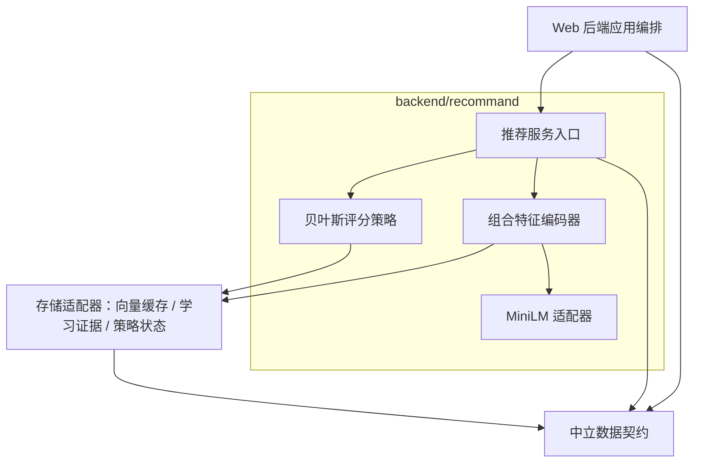
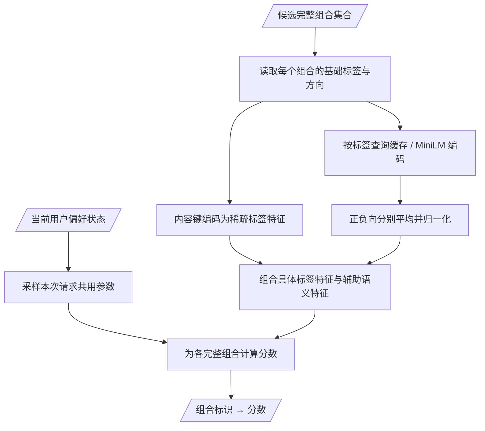

# 第一版推荐模块设计

状态：用户已授权按本计划实施。模块职责与跨模块边界沿用已确认架构；后续新增架构决定或接口变更须先提交增补设计并获得确认。实现及验证状态见 [架构说明](architecture.md#当前实现与目标的差异)。

## 第一版范围

- 先接入漫游，评分单位为候选模块返回的完整正负提示词组合。应用编排获取组合、请求评分、选择组合并提交任务；候选、推荐、任务模块之间不调用、不相互导入。
- 使用已试跑的 `sentence-transformers/all-MiniLM-L6-v2` ONNX CPU 模型，FastEmbed 适配，固定模型文件与预处理版本；不使用 GPU、远程编码 API 或运行时自动下载。复用已下载模型，正式模型缓存使用所选数据目录，不依赖试跑虚拟环境。
- 按配置中的基础标签分别编码、缓存；推荐特征与学习不使用管理类目、用户自建标签 ID 或标签库路径作为内容身份。
- 先实现具体标签特征与辅助语义特征的组合打分，保存状态并支持喜欢、不喜欢、撤回、重启恢复。第一版不学习复杂词间搭配。
- 手动生成和提示词编辑器原有行为保持；没有完整标签快照的历史图片不拆逗号、不用当前标签库模糊匹配补造归因。第一版学习仅使用有可验证快照的漫游图片。

## 接入基线

App 已能取得完整提示词组合及标签快照，`roam_jobs` 保留生成时的实际标签。第一版将原有直接选择候选的禁用策略替换为组合评分接口，并接入持久化反馈学习；图片反馈现已扩展为喜欢、不喜欢与撤回，详见 [不喜欢反馈](dislike-feedback.md)；没有曝光训练。

## 输入集合的边界

候选集合由应用编排传入。生成方式、数量、去重、枚举、规则合法性与连续性由候选模块负责；推荐模块为传入集合中的每个完整组合返回分数。最终组合的选择由应用编排负责。推荐设计不决定候选池范围，也不以候选模块的生成策略作为待确认或实施前置事项。

## 第一版学习目标

漫游的标准 / 强力力度分别映射到采样 / 后验均值评分，共用同一学习状态；强力确定性评分与接口增补见 [推荐力度](roam-recommendation-strength.md)。

使用显式喜欢/不喜欢学习正负关联，未评价保持未知，撤回移除对应证据。采用贝叶斯线性打分与 Thompson 式参数采样，但不宣称已建立曝光→点赞的完整转化率模型或校准点赞概率。如果希望根据展示后未点赞学习，需要另行确认曝光定义、观察窗口与未转化信号，不能擅自当成负反馈。

## 静态模块架构

箭头表示依赖，图中是逻辑职责，不新增独立服务进程。评分和学习先放在同一个策略组件中维护同一种状态，不另造两个参数体系。缓存与状态持久化由存储适配器实现，通过注入的协议使用；推荐业务不导入 SQLite 实现、HTTP、候选或任务模块。

建议文件边界：

| 位置 | 职责 |
| --- | --- |
| `backend/contracts/recommendation.py` | 中立的评分、反馈、状态 DTO 与存储协议；不依赖业务模块 |
| `backend/recommand/service.py` | 评分、反馈应用、状态查询入口；校验与协调内部组件 |
| `backend/recommand/features.py` | 内容身份、标签特征、正负向语义聚合、特征版本 |
| `backend/recommand/encoder.py` | FastEmbed MiniLM CPU 适配，按需加载与离线缓存 |
| `backend/recommand/policy.py` | 组合评分、偏好状态更新及参数采样 |
| `backend/store/recommendation.py` | 复用现有 SQLite 的向量、证据、状态持久化 |
| `backend/application.py` | 跨模块交互、选择组合、反馈与生成记录关联 |

不要求候选模块改为依赖推荐 DTO：App 将候选模块内部对象转换为中立评分输入。删除旧的推荐 `choose` 契约及其跨模块导入，候选编辑器的无作用 `choose` 调用一并移除。

## 输入输出契约

这是内部 Python 接口，不为评分另建 HTTP 服务。

| 接口 | 输入 | 输出与约束 |
| --- | --- | --- |
| `score(ScoreRequest) -> ScoreResult` | `request_id`、`user_id`、`sampling_seed`、完整组合列表、`strategy: thompson / mean`（默认 thompson） | 每个 `candidate_id` 的有限数值分数；特征版本、策略版本、状态修订；不选择、不修改组合 |
| `apply_feedback(FeedbackUpdate) -> LearningResult` | 用户、图片 ID、反馈修订、`value: 1 / -1 / null`、实际生成组合快照、特征版本 | 应用后的修订与 `applied / unchanged / pending` 状态；重复提交不重复学习，旧修订不覆盖新状态 |
| `status() -> RecommendationStatus` | 无 | 是否可用、模型/特征/策略版本、错误或降级原因；不触发下载 |

`ScoreCandidate` 包含 `candidate_id`、完整 `positive` / `negative`、有序 `terms`。每个评分标签只提供 `text`、`channel`；不传管理类目。完整文本和快照必须一致，权重语法保留在标签原文中，第一版不另行解释 ComfyUI 文本权重为学习权重。

当前用户固定为现有 `local`，协议保留 `user_id` 以便未来扩展，不新增登录、多用户页面。评分分数不是概率；同请求使用同一份状态快照和同一组采样参数。同请求 ID 与输入相同可按固定采样种子复现；幂等生成任务仍以现有入队事务为准，不把评分缓存当成任务幂等机制。

新增存储契约必须覆盖：批量读取/写入编码缓存、读取偏好状态、按反馈修订幂等应用/撤销证据、按期望状态修订提交更新、读取待处理学习通知。具体 Python 数据类字段以本文为实施约束；需要新增对外字段或改变交互时先提交增补设计。

## 特征与评分流程

- 内容键基于 Unicode NFC、首尾空白清理后的文本与正负向，保留大小写及内部标点/空白以避免误合并；同文同方向不同标签 ID 使用同内容键。向量缓存按文本、模型文件校验及预处理版本索引；方向通过后续分通道体现。
- MiniLM 为每个基础标签输出 384 维向量。保持短语整体，如 `long black hair`；不拆成单词，也不直接编码整段组合。正向与负向分别聚合，各 384 维，空方向填零向量；平均结果为零时保留零，不除零。超长单标签显式返回不可评分原因，不能静默截断。
- 具体标签特征按内容键保留，按方向作归一化；语义向量是辅助信息，平均聚合只代表大致主题，不承诺表达完整搭配含义。第一版暂用具体标签块权重 1、语义块权重 0.25，这些是待验证起点，变化计入特征版本。
- 语义部分固定 768 维；具体标签部分以内容键维护稳定索引，新增内容键只扩展先验参数，不重编号旧键。类目、路径、标签 ID 改动不改变编码。不同正负向即使文本相同也保留各自的具体特征。
- 无有效反馈时以共同零均值先验探索；学习状态有效时使用同一组采样参数对整个输入集合评分。推荐返回分数，由 App 决定选择策略及并列处理；模型不可用时返回明确状态与原因，由 App 决定后续处理。

## 第一版学习算法

只使用有完整快照的有效反馈，每张被评价图片作为一个组合样本，喜欢目标值 y=1，不喜欢 y=-1；未评价不生成 0 样本。一个任务输出多张图时按图片分别记录，同一图片重复反馈不重复计入。

采用带零均值正则先验的贝叶斯线性回归：对每个组合特征 x 保存充分统计量 `A = λI + Σxxᵀ`、`b = Σ(yx)`，预测参数均值为 `A⁻¹b`；按该线性高斯模型的后验不确定性采样参数，对组合计算点积。使用数值分解/求解，避免显式矩阵求逆。λ、观测噪声与探索尺度采用版本化配置，默认 1，验收中检查稳定性。

这是显式正负反馈的关联打分基线，不是完整的点击率学习：喜欢提高相似组合评分，不喜欢降低评分，Thompson 探索仍保留；未评价没有训练信号，共同出现的词仍有归因歧义。该局限必须在交付中保留，不能以算法名称掩盖。

撤回移除该图片对应的充分统计贡献；改变反馈先移除旧贡献再加入新贡献；重复同值反馈不增加贡献。数值检查失败时从有效证据重建，不能丢失原始反馈。新标签扩展参数与不确定性，并保留旧参数索引。第一版使用完整相关性矩阵，性能按现有约 375 标签和标签库上限场景验证；如果需要改为对角近似、哈希特征或低秩模型，属于新设计，先确认再修改。

## 反馈、恢复与存储

- App 根据图片 → 任务 → 生成时快照关联反馈，去掉管理类目后提交学习；缺快照的反馈仍正常保存，只不参与推荐学习。
- 喜欢/不喜欢/撤回与待处理学习通知在同一 SQLite 事务持久化，反馈接口随后返回当前状态。App 内单个事件唤醒后台任务调用学习入口并执行本次反馈触发的清理；启动、反馈和评分入口唤醒，不在请求内等待清空待学习记录，不新增定时器。失败保留通知，后续唤醒继续处理；详见 [后台偏好学习](feedback-background-learning.md)。
- 学习证据按 `(user_id, artifact_id)` 幂等保存有效状态及修订，策略状态和已应用通知修订原子提交。乱序反馈以最新持久反馈修订为准；崩溃后重放不会重复计数。
- 读取评分状态采用一致快照；学习提交核对状态修订，并发冲突重读后重试。MiniLM 与线性代数在工作线程执行，限制 CPU 编码线程，不阻塞 HTTP 事件循环。
- 向量缓存、内容键索引、有效/撤销证据、策略参数与待处理通知集中保存到现有 `data/pictide.sqlite3` 的新增推荐表；模型文件放在 `data/cache/embeddings/`。迁移前备份，不另建散落数据库。图片旁 JSON 继续只保存实际正负提示词。
- 第一次启用时导入仍有可验证历史快照的现有有效反馈，不推断历史曝光。标签库修改不改写已学习的历史文本。换编码模型或特征版本时，按保留的有效快照重编码并重建新版本状态，旧版本保留以便回退。

## 应用接入与验证

- 先替换 App 漫游的 `choose` 调用为评分与选择；Task 不新增推荐依赖，既有任务恢复、幂等与漫游缓冲逻辑继续复用。
- 保留现有图片反馈 HTTP 契约 `1 / -1 / null`。状态通过现有 bootstrap / 漫游响应的实际 `preference_learning` 字段及降级信息报告，不新增页面和独立评分端点。需要可见配置控件时先另提界面与接口设计。
- FastEmbed/ONNX 依赖正式安装到应用数据目录对应运行环境，版本锁定；不直接引用试跑环境。模型离线预检失败时保持应用可运行并报告原因。
- 实现阶段使用独立 worktree、数据目录与端口。测试覆盖模块边界、评分覆盖全池、标签缓存复用、正负向隔离、同文不同 ID、类目无影响、点赞幂等、撤回还原、重启恢复、乱序反馈、崩溃重放、版本隔离、冷启动探索与降级。
- 对模拟数据验证反馈能影响组合排序；对本地真实模型验证缓存、CPU 时间与内存，不把模拟学习效果当作真实用户推荐效果。不自动提交 ComfyUI GPU 生图。
- 部署前核对主实例状态、备份数据并提前通知重启；第一版实际推荐效果需后续用户反馈检验。

## 执行约束

仅实施已确认范围；架构与接口发生新决定时提交增补设计并等待确认。候选生成策略不属于本设计的待决事项。

## 实现限制

第一版保留完整相关性矩阵。状态大小随历史累计内容键数量平方增长，历史改词与多个标签库会累积新内容键，不受单个标签库1000标签上限约束。1000内容键时矩阵为1768维、约23.85 MiB；这是参数矩阵大小，不是进程总内存。未来压缩状态或近似协方差须另行设计确认。

当前评分时缺失或损坏的派生参数会从保留的学习证据重建用于评分，下次证据变化时持久化新的完整状态；撤回、重放与输入集合评分均已包含回归验证。MiniLM真实离线验收与性能报告存于数据目录，不能以模拟反馈效果代替真实用户推荐效果。
