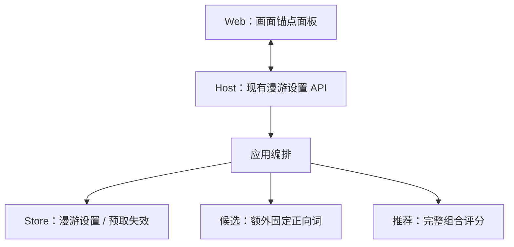
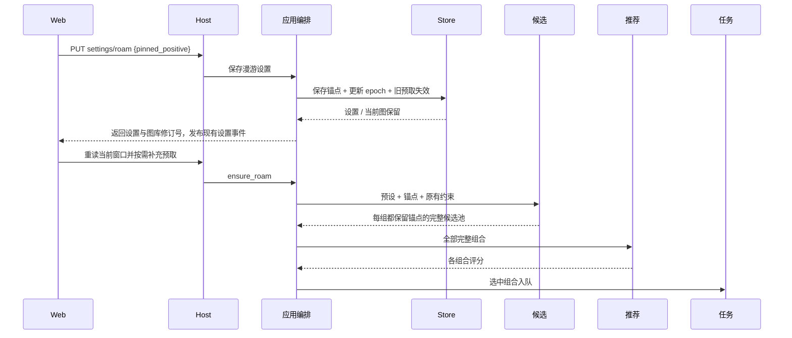

# 漫游画面锚点

## 概述

在漫游图片下方提供可折叠的「画面锚点」面板，点选正向提示词后让后续图片保留这些元素，增减锚点时清空旧预取。

## 架构

## 职责边界

| 接口 / 组成 | 变更 |
| --- | --- |
| GET/PUT /api/settings/roam、bootstrap.roam_settings | 新增 pinned_positive: string[]，默认 []；PUT 支持单独保存该字段，未提供则保留。 |
| Store.RoamSettings.get/save/save_options | SQLite 单独保存漫游锚点，有序去重；实际变化时同一事务更新 epoch 并复用 discard_roam_prefetch。 |
| CandidateProvider.generate(context, constraints) | constraints 新增 pinned_positive；候选模块把它与预设 base_positive 合并去重，作为本次临时固定正向词，不修改预设。 |
| Web：画面锚点 | 显示当前图片的正向词；点击立即增减锚点，支持清空；复用漫游设置保存、实时同步和切换窗口机制。 |
| 推荐 / 任务 | 接口保持；推荐继续评分、学习完整实际组合，任务保留最终提示词和既有快照。 |

锚点只影响漫游，不改变生成页、提示词预览或预设。沿用现有局域网共享设置，不新增用户体系。图像信息面板保持查看和复制用途。

## 调用和数据流

## 重点关注

- 面板位于普通漫游图片操作栏下方，默认折叠，标题「画面锚点」及数量；展开后锚点置顶，用图钉和选中样式区分，提供「清空锚点」。中英文及窄屏布局同步支持。
- 点击当前图片正向词设置 / 取消锚点，保存期间显示按钮反馈，成功后生效；保存失败保留原状态。负向词不在该面板参与固定。
- 预设原有固定词标注「来自预设」，不能在此取消；取消锚点表示解除额外保留，不排除该词再次被抽取。锚点跨切图、刷新和重启保留。
- 增加、取消或清空锚点均保留当前图和较旧历史；隐藏后续预取、取消未执行旧漫游任务，执行中的旧结果完成后隐藏。复用现有失效语义，隐藏文件按既有过期策略回收，不立即物理删除。
- 漂流和顺流均保留锚点。顺流的普通词变化仍按预算，用户主动修改锚点优先于预算；停泊保持整组提示词，面板可查看但暂不编辑，已有锚点保留，离开停泊后继续使用。
- 词库内锚点按现有固定词方式参与 PMI；自定义词保留原文、不参与统计。偏好范围和屏蔽关键词只限制新抽取词。锚点之间沿用固定词机制，不自行移除；无法扩展时返回已有词。
- 固定词合计超过预设长度上限时，临时把本次上下限至少提升至固定词数量，确保不会丢弃锚点；预设原值不变。
- 只做少数定向冒烟：候选保留与去重、顺流与停泊、设置持久化及旧预取失效；前端类型检查、构建和中英文窄屏交互验证。变更数据前备份，不提交真实 GPU 测试任务。