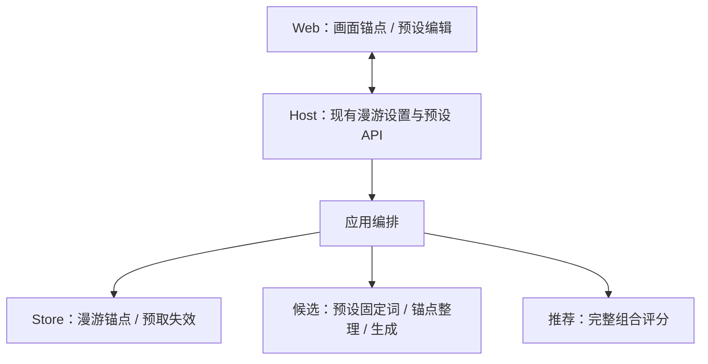
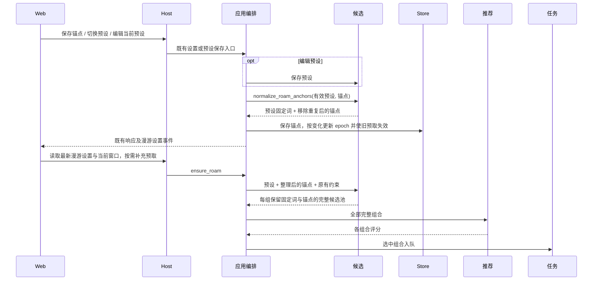

# 漫游画面锚点

## 概述

在漫游图片下方点选正向词设为画面锚点，预设固定词优先并移除重复锚点，增减锚点后保留当前图、清空旧预取。

## 架构

## 职责边界

| 接口 / 组成 | 变更 |
| --- | --- |
| GET/PUT /api/settings/roam、bootstrap.roam_settings | 新增 pinned_positive: string[]，默认 []，PUT 可单独保存；响应新增只读 preset_base_positive: string[]，表示实际使用预设的固定正向词，供面板标注来源。 |
| CandidateService.normalize_roam_anchors(preset_id, pinned_positive) | 返回 {preset_base_positive, pinned_positive}：读取预设、有序去重，并从锚点中移除与预设固定词重复的项；不保存漫游状态。 |
| Store.RoamSettings.get/save/save_options | SQLite 保存整理后的 pinned_positive 及内部预设固定词快照，用于识别固定来源变化；实际变化时同一事务更新 epoch 并复用 discard_roam_prefetch；不自行读取候选数据库。 |
| CandidateProvider.generate(context, constraints) | constraints 新增 pinned_positive；与预设 base_positive 合并为本次临时固定正向词，预设词在前、锚点在后，不修改预设。 |
| 应用编排 | 协调锚点整理、持久保存和预取失效；在启动、保存锚点、切换预设，以及编辑 / 删除当前有效预设后更新锚点状态，发布既有漫游设置事件。 |
| Web：画面锚点 | 显示当前图片正向词及固定来源，点击增减锚点，支持清空；复用漫游设置保存、实时同步与窗口切换机制。 |
| 推荐 / 任务 | 接口保持；推荐继续评分、学习完整实际组合，任务保留最终提示词和既有快照。 |

锚点仅影响漫游；生成页和提示词预览不使用漫游锚点。局域网沿用共享设置。图像信息面板继续负责查看和复制。

## 调用和数据流

## 重点关注

- **预设优先。** base_positive 与 pinned_positive 重复时，从 SQLite 保存的 pinned_positive 中真正移除重复项，不只是输出时去重，也不保留隐藏的锚点状态。比较沿用现有固定词身份规则，词库名的空格 / 下划线形式视为同一项，不做语义近似合并。
- **单一来源。** 面板展示三种状态：来自预设（锁定，不可取消）、画面锚点（选中，可取消）、普通词（可设为锚点）。预设固定词不计入锚点数量，也不受「清空锚点」影响。固定来源按当前有效预设判断，不按旧图片生成时的预设判断。
- **不会自动恢复。** black hair 原本是锚点，后来加入预设时从锚点删除；再从预设移除时，不会恢复成锚点，需要重新点选。
- **面板布局。** 普通漫游图片操作栏下方提供默认折叠的「画面锚点」面板，标题显示锚点数量；展开后锚点置顶，随后展示预设固定词与当前图片其余正向词，合并去重。锚点使用图钉和选中样式，预设词标注「来自预设」；提供「清空锚点」。中英文与窄屏布局同步支持。
- **点击与持久化。** 点击立即保存，按钮显示反馈，保存失败保留原状态。锚点跨切图、刷新和重启保留；取消锚点是解除额外保留，不是排除这个词。负向词不参与面板固定。
- **清空旧预取。** 增加、取消、清空或整理移除锚点，以及当前有效预设固定正向词变化时，保留当前图片与较旧历史；隐藏后续图片、取消未执行的旧漫游任务，执行中的旧结果完成后隐藏。隐藏文件按既有过期策略回收，不立即物理删除。无实际变化不重复清空。
- **漫游方式。** 漂流和顺流都保留锚点；顺流普通词继续按预算变化，用户主动修改锚点优先于预算。停泊保留整组提示词，面板可查看但不编辑；已有锚点仍保存，预设重复项仍整理，离开停泊后继续使用剩余锚点。
- **生成约束。** 词库内锚点按固定词方式参与 PMI，自定义词保留原文、不参与统计；偏好范围与屏蔽关键词只限制新抽取词。固定词之间沿用原机制，不自行移除；无法扩展时返回已有词。固定词合计超过长度上限时，临时提高本次上下限至至少固定词数量，预设原值保持。
- **首次启用。** 首次记录预设固定词基线时保留已有预取，后续真实变动才使窗口失效；没有配置锚点不会因本次发布清空预取。
- **验证。** 备份数据后，仅做固定来源转移 / 不自动恢复、候选保留、顺流与停泊、持久化及预取失效的定向冒烟；前端类型检查、构建和中英文窄屏交互检查，不提交真实 GPU 测试任务。
实施采用现有 shadcn Collapsible、Button、Badge；完整固定项包含逗号时保持为同一词项，不拆出重复的普通词。预设保存事件同样刷新漫游锚点来源，避免通知合并后显示旧状态。
