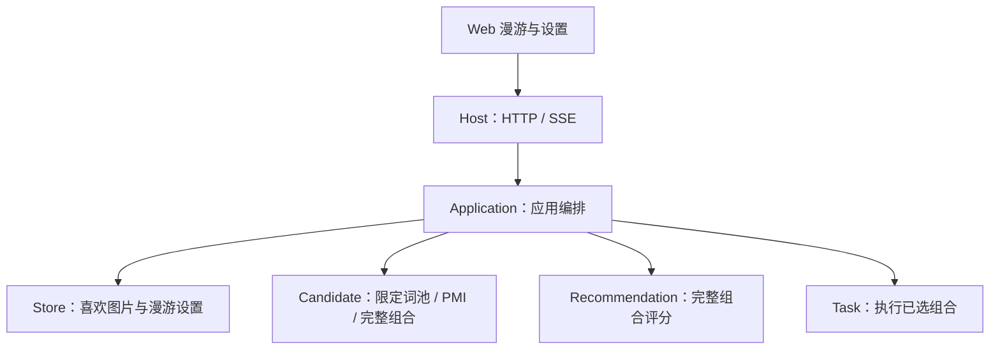

# 漫游：仅从喜欢图片中抽取标签（已确认）

状态：用户已确认，按本文实施；包括补充的漫游页菜单和设置页播放间隔。

## 1. 架构

不新增服务或页面。漫游页与设置 → 漫游共同提供默认关闭的“仅从喜欢图片中抽取标签”开关；它控制候选范围，推荐继续为完整组合评分，任务执行选定组合。

图表示模块依赖；Candidate、Recommendation、Task 互不调用。候选不查询用户反馈表，推荐不负责生成或筛选词池。SQLite 查询由 Store 负责，Application 不执行 SQL。

## 2. 页面与状态

- 漫游页右上角将当前播放间隔、毛玻璃、沉浸模式等独立入口收进一个“漫游选项”图标按钮，使用现有 shadcn Popover，点击打开，再点或 Esc/点击外部收起。面板提供播放/暂停、每张展示秒数、仅从喜欢图片抽取开关、毛玻璃开关、进入沉浸模式。底部播放/暂停按钮继续保留，方便常用操作；它与菜单显示同一个播放状态。
- 设置 → 漫游增加同一个候选范围开关和“每张展示（秒）”输入框，范围 1–600、默认 5；随原“保存设置”按钮保存。不新增持久化的自动播放开关，刷新或离开漫游仍按现有规则暂停。
- 目前播放间隔已经通过 GET/PUT /api/settings/roam 的 playback_interval_seconds 保存，SQLite 表为 roam_playback_settings，位于 data/pictide.sqlite3。此次复用，不另存浏览器配置或新增接口。
- 漫游菜单的候选开关点击后单独保存；播放秒数使用输入框及保存按钮。仅提交当前修改字段，成功后通过既有 roam_settings/SSE 同步两个入口，不覆盖预取数量、后端、预设或其他未保存字段。
- 毛玻璃与播放/暂停是当前页面的即时状态，沿用现有按钮和快捷键；沉浸模式仍是即时操作，进入后关闭选项面板，沉浸操作栏保持现有布局。

## 3. 行为与范围

- 开关仅影响漫游新创建的任务；生成页和提示词预览保持原行为。切换开关沿用设置 epoch 机制，已生成、已排队和正在执行的任务保留，后续准备任务采用新范围。
- 限制随机抽取的正向标签。固定正向锚点与固定负向词继续按当前预设输出，即使没有出现在喜欢图片中；固定正向锚点仍参与 PMI 条件。负向提示词不进入可抽取词池。
- 词池来自当前用户反馈为 1、未删除图片的实际正向提示词，覆盖漫游与生成两个来源。生成页隐藏或漫游历史隐藏不排除仍被喜欢的图片；不喜欢、未评价与撤回喜欢的图片不贡献词池。
- 当前生成页没有结构化标签快照，因此统一使用实际提交的正向文本，按项目现有逗号分隔约定拆成词项，在候选模块中做首尾空白、空格/下划线规范化，并与当前只读词库精确匹配。未知自由文本、权重表达式及别名不猜测含义、不通过语义模型扩展，也不写回历史快照或推荐学习证据。
- 同一标签出现多次只取得一次入池资格，不额外按喜欢图片次数加权；已有词频/PMI 抽样权重和推荐评分机制保留。组合可以跨多张喜欢图片重组，并继续检查当前预设的 PMI、最低共现次数和数量目标；不能保证每个入池标签都得到用户独立认可。
- 喜欢、撤回或改为不喜欢后，下次准备候选时重新读取集合。同一标签仍在其他喜欢图片中出现就继续保留；不维护第二份持久词池或引用计数。
- 词池非空但 PMI 或搜索上限无法达到目标长度时，沿用现有部分结果行为，不降低门槛，也不从池外补词。
- 词池为空时不派发新任务，不静默退回全词库，不记录为需要重新保存设置才能解除的漫游暂停。现有图片可继续浏览和播放；用户请求下一张而无图时，结束本次加载等待并提示“喜欢图片中暂无可用标签，请先喜欢图片或关闭此开关”，自动播放到末尾时暂停。预取开启时，后续喜欢反馈/SSE 或页面事件会自然再次尝试；预取为 0 时由下一次主动请求触发。

## 4. 调用与数据流

1. 漫游选项面板与设置页通过既有漫游设置接口保存开关/播放间隔；Host 转交 Application，再由 Store 保存 SQLite，发布既有 roam_settings 事件同步两个入口。播放状态仍只在 Web 控制，不提交持久化。
2. 既有 /api/roam/ensure 判断库存确实需要新任务后，Application 在开关开启时调用 Store，获取当前喜欢图片的去重正向提示词。
3. Application 调用 Candidate.resolve_tag_pool，将这些文本转换为当前词库中的唯一原名标签集合。每次准备一池组合时只解析一次；空集合直接返回等待原因。
4. Application 把 allowed_positive_tags 作为本次候选约束传给 CandidateProvider.generate。候选在每次随机选择前限定允许集合，并检查 PMI；无初始锚点时的首次抽取同样受限。
5. Candidate 返回完整组合及既有快照 → Application 调用 Recommendation.score → Application 选择组合 → Task 入队。推荐、任务和图片反馈学习接口均不变。
6. 已保存任务与快照不受后续喜欢集合变化影响；集合变更与候选准备并发时，以本次读取的集合为准，下次准备再读取新集合，不增加跨数据库事务或取消既有任务。

## 5. 接口

| 所属 | 调整 | 含义 |
| --- | --- | --- |
| HTTP 设置 | GET/PUT /api/settings/roam 增加 liked_tags_only: boolean | 默认 false；完整设置保存时提交，省略保留原值；也接受仅含 liked_tags_only、playback_interval_seconds 或二者的局部保存，未提交字段保留。仅修改间隔不改变 epoch，候选范围变更按原设置规则更新 epoch。bootstrap 内的漫游设置同步返回。 |
| HTTP 漫游 | POST /api/roam/ensure 增加 waiting_for_liked_tags: boolean | 默认 false；需要补图但喜欢词池为空时为 true，保持 paused=false、不创建任务。其他暂停和错误语义不变。 |
| Store | liked_positive_prompts(actor_id="local") -> list[str] | 返回仍被喜欢、未删除图片的去重实际正向文本；包含两个来源，不解析提示词，不依赖候选或推荐。 |
| Candidate | resolve_tag_pool(positive_prompts: Sequence[str]) -> tuple[str, ...] | 解析并精确匹配当前词库，返回排序、去重的原名标签；空池返回空 tuple。 |
| CandidateProvider | generate(context, constraints) 的 constraints 增加 allowed_positive_tags: Sequence[str] 或 None | None 表示全词库；空集合表示没有可抽取标签，不能当作无限制。count 及返回的 Sequence[Candidate] 不变。 |

限制通过内部调用传递，不给 /api/candidate/generate 增加新 HTTP 参数，不写入共享生成预设。候选适配器批量解析词池并在邻居交集/首次词频候选中应用允许集合；同一池内多个组合复用该集合，不先从全库抽完再过滤。

## 6. 数据与验证

开关保存于 data/pictide.sqlite3 的 roam_settings，新增 liked_tags_only INTEGER NOT NULL DEFAULT 0，约束为 0/1。实施前备份当前主数据库，做本次最小字段调整，不建立迁移框架。词库、喜欢记录、模型状态、已入队任务和原图片保留；不复制标签数据库，不重处理 Danbooru 数据。

最小冒烟覆盖：关闭时原行为、开启后抽取词均在池内且固定词保留、正负向及两种图片来源、重复/撤回后的集合变化、空池等待与后续恢复、PMI 不足返回部分结果。前端类型检查、构建及菜单展开/收起、两处设置同步、局部保存保留无关配置、播放状态共用、设置开关/空池反馈的隔离页面验证；不提交真实 GPU 任务。需要后端重启时提前告知并核对活动任务。

## 7. 实施验证

候选与存储定向冒烟已通过；应用 HTTP 冒烟核实空池不暂停、喜欢反馈后恢复、受限抽取且固定正负词保留，以及局部保存原子校验和重启持久化。前端类型检查、构建和隔离浏览器冒烟通过：菜单/底栏播放状态一致、两处设置双向同步且保留无关草稿、沉浸模式空格/退出焦点正常、空池结束加载并提示。数据库副本新增字段后，20 张表原有数据校验一致。不提交真实 GPU 任务。

已集成发布至主目录并重启 8189 实例。发布前备份位于 `data/backups/roam-liked-tags-20261017-150215/`；离线增加字段前后 20 张表原有数据一致，143 条喜欢记录、原设置与任务状态保留。正式设置页与静态产物版本核对通过，新开关保持默认关闭；证据位于同名 `data/verification/` 目录。
