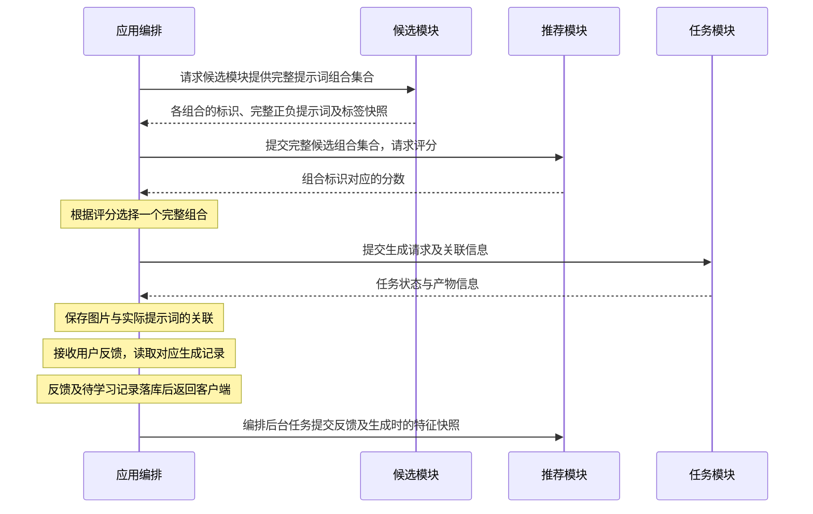
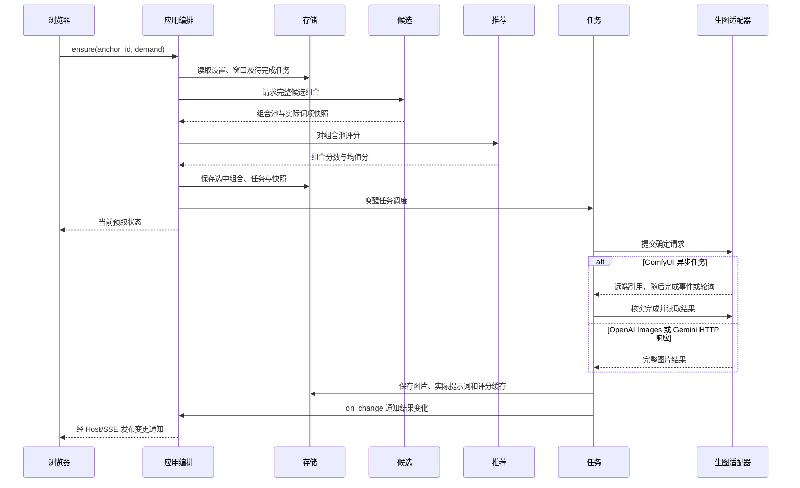
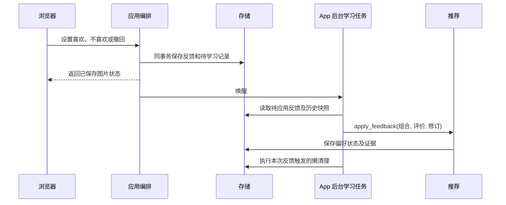

# 调用和数据流

[English](../../../dev/architecture/flows.md)

[架构概览](../architecture.md) · [API 入口](../api.md)

这里说明现有模块间的调用顺序与数据关联；静态职责以架构概览为准。

## 候选、评分与生成

- 候选模块先根据标签库与规则提供本次请求的全部候选提示词组合，每个候选都是可提交生成的完整正负提示词，包含组合标识、标签快照及版本；共现门槛与连续预算由候选模块处理；共现不足时组合可能短于目标长度。
- 推荐模块对 App 提供的完整组合评分，返回组合标识与分数，不逐词打分后交回抽取，不新增、修改或删除组合。Thompson Sampling 的探索体现在组合评分中。
- App 获取候选组合集合，交给推荐模块评分，再根据评分选择一个完整组合并提交任务；不将评分交回候选模块重新组装提示词。任务模块只接收确定的生成请求。推荐不可用时，由 App 在既有合法组合中按默认策略选择。
- 生成记录保存所选组合及实际标签内容与版本；反馈由 App 关联历史记录后交给推荐模块，不以最新标签库重新解释历史，也不把一次点赞直接视为喜欢全部标签。撤回喜欢不等同于不喜欢。

## 手动生成批次

App 接收每次数量和生成次数，必要时调用 Candidate 逐轮产生完整文本，再一次校验并保存整批任务。Task 执行确定的生成请求，不重新抽词。每轮内共用提示词；支持图像种子的后端逐任务独立随机或按序递增。云端适配器拒绝非空负向提示词和指定图像种子；候选种子仍只在本地控制提示词选择。

批次幂等与容量检查在存储事务中执行，不足时整批拒绝；同一 request_id 重试恢复原计划，不再次抽取。新计划最多 100 个待处理任务，旧式无 repetitions/candidate 的提交沿用 10 个入队门槛。具体字段见[任务接口](../reference/api/jobs.md)。

## 漫游预取与出图

浏览器在进入漫游、切图、任务状态更新等入口检查缺口，不另设投喂循环。每次 ensure 最多创建一个任务，最多两个未完成漫游任务，让提示词准备与上一张出图重叠；全应用最多两个任务在后端在途，手动任务优先占用新空位。Task 收到完成事件后核实状态、补位并保存结果；ComfyUI 事件不可用时回退轮询。OpenAI Images 与 Gemini 经异步 HTTP I/O 等待同步完整结果，将 Base64 或 URL 下载图片存入本地。它们没有远端恢复引用；超时或中断的提交保持不确定，不自动重发。新选择的云端漫游后端先关闭预取，用户明确开启后再预取。

ComfyUI 建立连接失败属于确定的提交失败并释放名额。不确定任务始终不重发：Task 按请求 ID 查询后端队列和历史；查询成功且未找到时释放名额，保留不确定记录以继续恢复迟到结果；查询失败时保留占用。见[队列恢复记录](../issues/roam-queue-recovery.md)。

切换偏好范围、漫游方式或锚点时，App 经 Store 保存设置与预取失效状态，迟到产物隐藏。顺流从实际选中组合继续，停泊复用整组提示词；候选、推荐和任务之间始终不直接交互。

当前设置版本失败、状态不确定或取消时暂停预取。保存完整漫游设置可解除暂停；修正并保存当前漫游后端也可恢复。保留历史图片和任务，不自动重提旧失败任务。详情见[漫游指南](../../guides/roam.md)、[预取接口](../reference/api/roam.md)和[事件设计](../issues/task-events.md)。

## 反馈与后台学习

学习使用当时实际文本、方向与组合关联，不按当前词库重解释历史。未评价是未知，撤回取消原贡献；反馈请求成功表示已保存，不能据此认定推荐已经学习完成。模型暂不可用时记录保留，由后续操作唤醒处理。详情见[后台学习记录](../issues/feedback-background-learning.md)。

## 进一步查阅

- [生图提交窗口设计](../issues/task-window.md)
- [存储与图片来源](../reference/storage.md)
- [推荐内部特征流程](recommendation.md)
