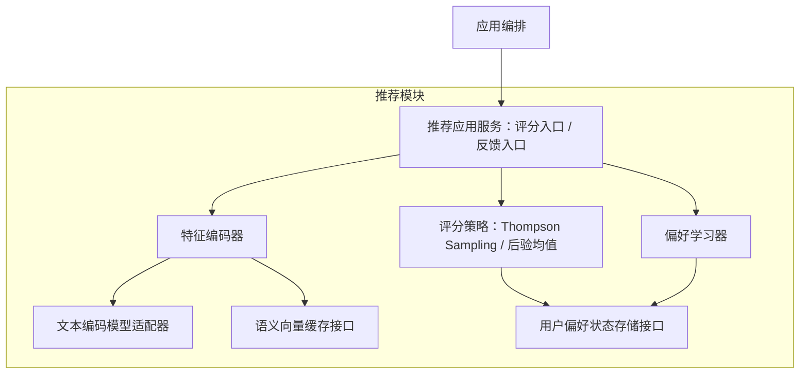
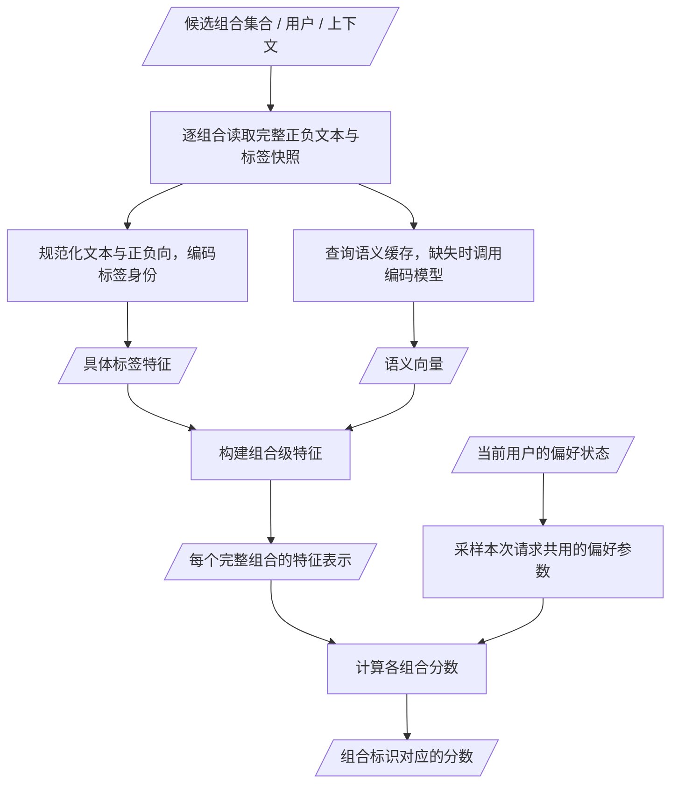

# 推荐模块

[English](../../../dev/architecture/recommendation.md)

[架构概览](../architecture.md) · [推荐 HTTP 接口](../reference/api/preferences.md)

推荐接收完整候选组合并返回评分，不生成候选，不调用任务模块。先了解职责，再按需阅读特征流程与模型准备。

## 推荐模块内部架构

推荐模块只通过 App 接收完整候选提示词组合及反馈，评分单位是一个组合。词库 ID 与类别不进入推荐内容身份；同一文本与正负方向使用相同内容特征。

架构图只表达逻辑组件及调用依赖，箭头表示调用或依赖，不表示数据先后流动。这些是模块内部职责划分，不要求拆成独立进程或服务。

推荐应用服务协调内部编码、评分与学习：评分时取得组合特征并调用评分策略；反馈时取得实际生成组合的特征，并将特征、反馈及记录标识一起交给偏好学习器。两条用例分别触发，推荐内部不调用候选或任务模块，也不直接读取它们的实现或标签库文件。模型适配器封装固定版本的文本编码模型；缓存和偏好状态存储接口由持久化适配器实现。

## 推荐评分的数据处理流程

下图以标准力度为例，表达一次评分请求的数据与处理步骤。标签内容特征、语义向量和组合级特征是数据产物；内容编码、语义编码和特征组合是处理步骤。上图的特征编码器负责这些步骤，实现位于 `backend/recommand/features.py` 与 `policy.py`。

学习入口走独立流程：读取实际生成组合快照 → 使用同版本特征编码器 → 将组合特征与用户反馈关联 → 更新偏好状态。一次评分请求不执行这条学习流程。[模块调用时序](flows.md#候选评分与生成)说明 App 与候选、推荐、任务模块的调用顺序，不代替静态架构图。

- 组合标识用于将分数交回 App；标签内容身份用于在不同组合间学习和共享经验。规范化文本与正负向定义标签内容身份，同文不同 ID 可复用内容特征；近义或反义词仍保留各自的具体标签特征，语义向量不自动合并偏好。
- 组合级特征由具体标签的稀疏特征与分正负向聚合的语义向量构成，对外只返回完整组合分数；第一版为线性模型，不声明已学习复杂搭配关系，具体约定见 [推荐模块设计](../issues/recommendation-v1.md)。
- 标准力度下，同一请求的所有组合使用同一组采样偏好参数进行比较；强力使用后验均值，不采样。推荐返回评分后，由 App 选择组合并调用 Task，不再调用 Candidate 按分数抽词。
- 冻结的 MiniLM 按基础标签编码，向量缓存包含文本、模型文件、运行依赖与预处理版本。用户点赞更新偏好状态，不训练文本编码模型。
- 学习输入为 App 提供的实际生成组合及反馈，使用当时的文本、正负向与特征版本，不采用最新类目或标签内容替代历史。整张图片的喜欢/不喜欢按组合学习 +1/-1，不直接转换为每个标签独立的反馈；未评价保持未知，撤回应撤销对应贡献或重放有效反馈，不当作负反馈。
- 用户偏好状态按用户及特征版本隔离。更换编码器时重新编码并基于历史有效反馈重建状态，不混用不同向量空间；缓存与策略状态通过存储接口保存在应用数据目录。当前算法及边界见下文；更换编码模型需要另行设计确认。

## 当前能力与限制

第一版已实现 MiniLM CPU 离线标签编码、完整组合评分、贝叶斯线性后验采样、显式正负反馈学习、撤回和重启恢复。App 先接收候选组合集合，传给推荐服务 `score`，再选择组合提交任务；旧 `choose` 接口和推荐对候选模块的类型导入已移除，中立契约位于 `backend/recommendation/contracts.py`。

学习使用显式正负反馈的组合关联，未评价保持未知；评分不是点赞概率，也未实现曝光/未转化学习、复杂搭配或图像特征。模型缺失或不可用时报告状态，App 保留既有默认候选处理，不把降级称为学习。bootstrap 的 `recommendation` 返回可用状态与版本，`preference_learning` 根据实际可用状态报告；学习通知未成功应用时保留重试，用户反馈不回滚。偏好查看与重置复用 Web → Host → App → Recommendation → Store 链路；查看只读当前学习状态，重置原子清除全部特征版本偏好并记录反馈事件分界，保留图片和反馈。详见 [第一版推荐设计](../issues/recommendation-v1.md) 、[偏好查看与重置](../issues/recommendation-preferences.md) 与 [不喜欢反馈](../issues/dislike-feedback.md)。

## 评分与反馈的运行方式

标准力度使用 Thompson Sampling，强力使用确定性后验均值，两者共享用户偏好。App 选择分数最高的完整组合，不把分数交回 Candidate 重组。具体标签身份与语义特征共同参与线性评分；近义或反义标签不自动合并。

反馈与待学习记录同事务保存后立即返回。App 的单个后台学习任务处理持久记录；评分只使用已完成的偏好状态，不等待本次反馈学习。模型不可用时保留反馈供后续处理，已有预取不会因为一次新反馈失效。

图片信息中的偏好评分复用确定性原始分缓存，手动刷新才重算已有缓存；界面的 0–100 是历史范围相对刻度，不是喜欢概率。详见[评分接口](../reference/api/images.md#喜欢筛选与图片偏好评分)和[缓存设计记录](../issues/image-score-cache.md)。

## 推荐依赖准备

推荐依赖 [MiniLM](https://huggingface.co/Qdrant/all-MiniLM-L6-v2-onnx) 负责文本向量编码，使用离线 FastEmbed 格式的 ONNX 文件。`backend/recommand/model.json` 统一定义固定来源版本、五个必需文件、字节数与 SHA-256。`backend/recommand/resources.py` 将文件准备并校验到所选数据目录的 `models/minilm/`，支持断点续传；已有无效文件在成功替换前保留备份。

源码与便携启动共用 `backend/application.py` 的 `PictideApplication.prepare_startup()`：先初始化随包词库，再准备模型。准备成功后，Host 才创建 HTTP 服务并打开页面。下载或校验失败则终止启动；重启后利用保留的 `.part` 文件重试。有效本地文件支持离线启动。用户步骤见[启动与离线模型准备](../../guides/getting-started.md#推荐依赖准备)，边界变化见[启动前准备设计](../issues/minilm-startup-download.md)。

便携构建携带固定清单与 CPU 推理依赖（FastEmbed、ONNX Runtime、tokenizers），不下载或打包模型权重。编码器继续只读本地模型；运行中的编码器可用状态通过 bootstrap 的 `recommendation` 和漫游响应报告。Python 3.12 已完成验证，较旧 Python 的兼容依赖由安装器选择。

## 进一步查阅

- [第一版算法与内部契约](../issues/recommendation-v1.md)
- [后台学习的确认设计](../issues/feedback-background-learning.md)
- [用户偏好查看、导出和重置接口](../reference/api/preferences.md)
