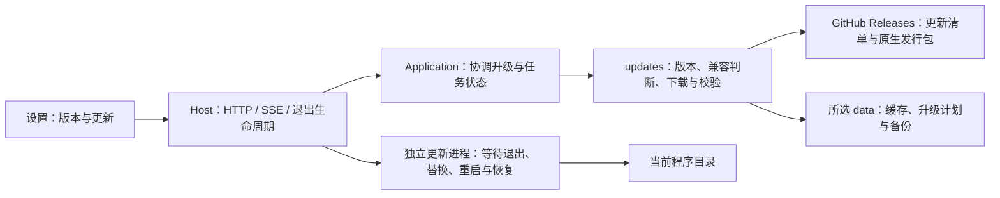
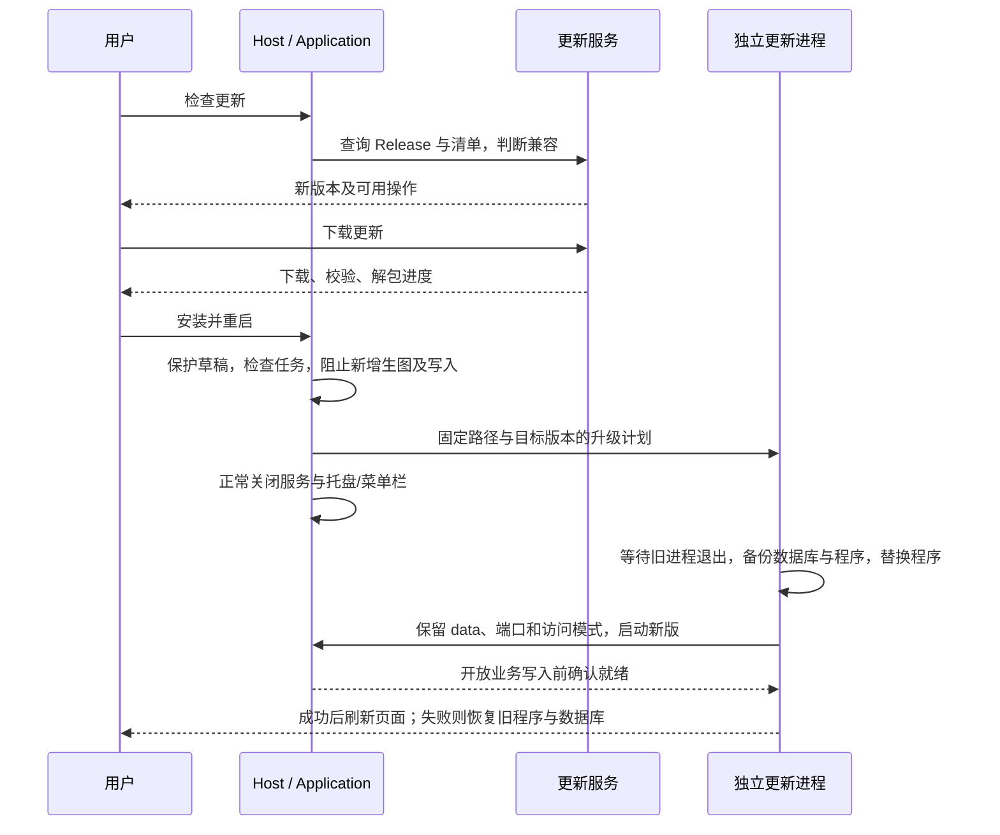

# 检查更新与兼容升级（待确认）

## 概述

在设置中检查正式版本；发行方明确声明支持从当前版本升级时，用户可直接下载、安装并重启，保留原有数据。

## 架构

- 增加 `backend/updates/`，模块自己的 `contracts.py` 定义版本检查结果、升级计划和进度；版本检查及下载不依赖 Candidate、Recommendation 或 Task。
- Host 装配更新服务并处理 HTTP、SSE 和关闭；Application 负责协调任务、安装状态与用户操作。更新器不直接调用业务模块。
- 独立更新进程复用已下载发行包的程序入口，通过专用内部模式运行，不启动模型准备或 Web 服务；等旧进程退出后才替换文件。不增加 GUI 框架或独立安装运行时。
- 更新安装服务端程序；同一实例的所有浏览器共享升级进度，不分别更新前端。

## 职责边界

### 版本与兼容性

- 用户点击「检查更新」后访问固定项目的 GitHub Releases，取最新正式版，跳过草稿和预发布。首版不定时检查或静默安装。
- Release 增加 `update.json`，由 tag 构建流程生成，包含版本、允许直接升级的来源版本范围，以及各平台/架构的文件名、大小、SHA-256。
- 来源版本范围由随源码维护的发行策略明确指定，不从主次版本号推断兼容性。含义是：新程序可读取当前数据，并保留图片、任务、喜欢、偏好及配置；允许的迁移必须纳入验证。
- 只有目标版本更新、来源版本落在允许范围、清单格式受当前更新器支持、平台/架构匹配且安装目录可写时，提供直接升级。缺少清单或不满足兼容条件时，只提供发行页和手动升级说明。
- 清单中的发行版本、资产名及校验值必须与选中的 Release 对应；只下载固定项目的 Release 资源，不执行清单传来的命令。沿用系统代理与 TLS 验证。
- 源码运行可检查版本并打开发行页，不用发行包覆盖 Git 工作区。安装操作仅允许从本机访问；局域网客户端可以查看版本和更新状态。

### 接口

| 接口 | 职责 |
| --- | --- |
| `GET /api/updates` | 当前版本、安装能力、最近检查结果及共享进度 |
| `POST /api/updates/check` | 用户发起正式版本检查 |
| `POST /api/updates/download` | 下载已检查的目标版本，校验并暂存，不接受客户端提供下载地址或安装路径 |
| `POST /api/updates/install` | 确认安装已校验的目标，重新检查版本、目录及任务状态，交接独立更新进程 |

通过现有 SSE 发布 `updates` 事件，前端按需读取状态。检查/下载重复点击复用同一个操作；同时只允许一个安装过程。

### 界面

- 通用设置增加当前版本与「检查更新」。发现兼容版本时显示版本号、发行说明链接和「下载更新」。
- 下载使用局部进度；完成后显示「安装并重启」。安装前提示会短暂中断服务，并处理尚未保存的界面草稿。
- 有进行中或排队的生图任务时暂不安装，保留已下载的包，待任务结束后重试；不强行终止任务。
- 检查失败等临时结果沿用右上角通知，下载和安装进度留在原有设置区域。

## 调用和数据流

- 升级缓存和计划放在所选 `data/cache/updates/`、`data/tmp/updates/`；备份在 `data/backups/updates/`。数据库在旧进程退出后创建一致备份，保留最近一次成功升级前的恢复点。
- 只替换包内明确归属程序的文件，不同步删除整个安装目录。保留所选 data、`pictide.local.json` 及用户额外文件；不重新下载已准备好的 ComfyUI、模型或词库。
- Windows 替换 `Pictide.exe`、`_internal/` 等发行文件；更新进程运行在暂存目录，避开运行中文件锁。
- macOS 整体替换 `.app`，沿用原生解包工具保留框架链接与权限；原生启动器配合退出，等待启动器与 Python 服务都结束。沿用现有签名方式，不修改系统安全设置或自动移除 quarantine；系统拒绝运行时提供手动更新路径。
- Linux 替换发行包的启动入口和 `data/runtime/pictide/` 等程序文件，保留其余 data；重启保留原命令行模式。
- 新版就绪确认前不接受业务写入；失败恢复程序与升级前数据库。确认成功后重新读取前端资源，避免新后端继续搭配旧页面。

## 验证与发布

- 少量单元/集成检查：兼容范围、版本及平台匹配、旧发行缺清单、下载中断/校验失败、拒绝任意地址或路径、进行中任务阻止安装、导入边界。
- 模拟发行服务与临时安装目录验证完整替换、保留自定义 data/模型/词库、重启及失败恢复；浏览器验证检查、下载、重启状态和错误通知。模拟验证与原生包验证分开记录，不提交真实生图。
- Windows、macOS、Linux 的实际发行包分别做升级冒烟；未通过的平台不开放直接安装。
- 仍仅在推送版本 tag 时触发发行工作流。现有 v0.5.0 不含更新入口，本功能需先随新版手动安装一次，后续兼容版本才可在应用内升级。

参考：[GitHub Releases API](https://docs.github.com/en/rest/releases/releases)。
