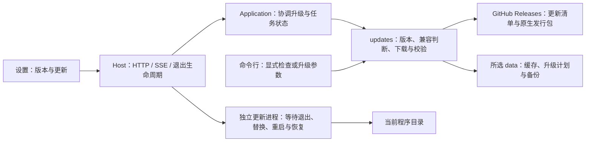
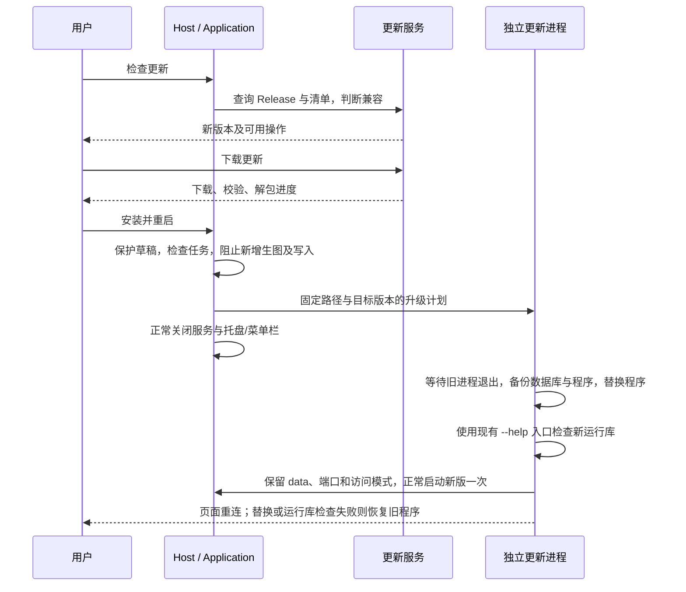

# 检查更新与兼容升级（已实现）

## 概述

用户通过设置或命令行主动检查正式版本；发行方明确声明支持从当前版本升级时，可主动下载、安装并重启，保留原有数据。禁止自动检查和自动更新。

## 架构

- 增加 `backend/updates/`，模块自己的 `contracts.py` 定义版本检查结果、升级计划和进度；版本检查及下载不依赖 Candidate、Recommendation 或 Task。
- Host 装配更新服务并处理 HTTP、SSE 和关闭；Application 负责协调任务、安装状态与用户操作。更新器不直接调用业务模块。
- 独立更新进程复用已下载发行包的程序入口，通过专用内部模式运行，不启动模型准备或 Web 服务；等旧进程退出后才替换文件。不增加 GUI 框架或独立安装运行时。
- 更新安装服务端程序；同一实例的所有浏览器共享升级进度，不分别更新前端。
- GUI 与 CLI 共用版本来源、兼容判断、下载校验、安装及恢复逻辑；CLI 参数在普通启动和依赖准备之前处理。

## 职责边界

### 手动触发约束

- 检查、下载、安装只能由用户点击对应按钮或执行明确的命令行参数触发，不提供自动更新开关。
- 应用启动、打开设置、恢复窗口、后台运行、定时任务及普通状态读取均不查询远端版本，不下载或安装更新。
- 界面下载完成后仍需用户点击「安装并重启」；存在缓存更新包也不会在下次启动时自动安装。
- 下载失败不在后台自动重试；生图任务结束后也不自动安装，需要用户再次发起操作。用户主动发起的一次安装可以完成其重启、就绪确认与失败恢复流程。

### 版本与兼容性

- 用户点击「检查更新」或执行对应 CLI 参数后，访问固定项目的 GitHub Releases，取最新正式版，跳过草稿和预发布。
- Release 增加 `update.json`，由 tag 构建流程生成，包含版本、允许直接升级的来源版本范围，以及各平台/架构的文件名、大小、SHA-256。
- 来源版本范围由随源码维护的发行策略明确指定，表示新版本支持从哪些版本升级，不从主次版本号推断兼容性。更新器只判断当前版本是否落在范围内，所需的数据初始化或迁移由新版本在正常启动时负责。
- 只有目标版本更新、来源版本落在允许范围、清单格式受当前更新器支持、平台/架构匹配且安装目录可写时，提供直接升级。缺少清单或不满足兼容条件时，只提供发行页和手动升级说明。
- 清单中的发行版本、资产名及校验值必须与选中的 Release 对应；只下载固定项目的 Release 资源，不执行清单传来的命令。沿用系统代理与 TLS 验证。
- 源码运行可检查版本并打开发行页，不用发行包覆盖 Git 工作区。安装操作仅允许从本机访问；局域网客户端可以查看版本和更新状态。

### 接口

| 接口 | 职责 |
| --- | --- |
| `GET /api/updates` | 当前版本、安装能力、最近检查结果及共享进度；仅返回本地状态，不触发远端检查 |
| `POST /api/updates/check` | 用户发起正式版本检查 |
| `POST /api/updates/download` | 下载已检查的目标版本，校验并暂存，不接受客户端提供下载地址或安装路径 |
| `POST /api/updates/install` | 确认安装已校验的目标，重新检查版本、目录及任务状态，交接独立更新进程 |

通过现有 SSE 发布 `updates` 事件，前端按需读取状态。检查/下载重复点击复用同一个操作；同时只允许一个安装过程。

### 命令行

| 参数 | 行为 |
| --- | --- |
| `--check-updates` | 仅查询正式版本，输出当前/最新版本、兼容结果和发行页地址；不下载、不安装 |
| `--update` | 用户显式请求一次完整升级：检查兼容性、下载校验、检查任务后安装并重启；已是最新版时正常退出 |

- 两个参数互斥。检查成功返回 `0`，无论是否有新版本；网络或执行失败返回非零。`--update` 遇到不兼容、不可安装或未完成任务时说明原因并返回非零，保留已下载资源，不持续等待或稍后自动重试。
- 检查更新不启动 Web 服务、托盘/菜单栏、首次准备向导或 MiniLM 下载；命令行操作在终端显示结果和必要进度，不弹出更新 GUI。
- 有运行中的同一实例时，安装请求交由该实例协调退出；没有运行实例时执行相同的安装前置检查及独立更新流程，不能绕过任务保护和数据备份。CLI 与 GUI 的并发操作仍只允许一次安装。
- 支持现有 `--data-dir`、`--port` 等定位参数；重启保留原有数据位置、端口和运行模式。源码运行支持检查，直接升级仍限原生发行包。
- Windows 示例：`Pictide.exe --check-updates` / `Pictide.exe --update`。macOS 可向 `.app` 内的原生可执行入口传参；Linux 沿用 `./start.sh --check-updates` / `./start.sh --update`。各端启动器需直接转发这两个参数，避免误入普通启动流程。

### 界面

- 通用设置增加当前版本与「检查更新」。发现兼容版本时显示版本号、发行说明链接和「下载更新」。
- 下载使用局部进度；完成后显示「安装并重启」。安装前提示会短暂中断服务，并处理尚未保存的界面草稿。
- 有进行中或排队的生图任务时暂不安装，保留已下载的包，待任务结束后重试；不强行终止任务。
- 检查失败等临时结果沿用右上角通知，下载和安装进度留在原有设置区域。安装后最多等待两分钟重连，超时停止轮询并提示查看日志，不自动重试更新操作。

## 调用和数据流

- 升级缓存和计划放在所选 `data/cache/updates/`、`data/tmp/updates/`；备份在 `data/backups/updates/`。数据库在旧进程退出后创建一致备份，保留升级前的恢复点，不自动删除历史备份。
- 只替换包内明确归属程序的文件，不同步删除整个安装目录。保留所选 data、`pictide.local.json` 及用户额外文件；不重新下载已准备好的 ComfyUI、模型或词库。
- Windows 替换 `Pictide.exe`、`_internal/` 等发行文件；更新进程直接使用缓存中的已校验暂存包，避开运行中文件锁，不再复制整份助手运行库。
- macOS 整体替换 `.app`，沿用原生解包工具保留框架链接与权限；原生启动器配合退出，等待启动器与 Python 服务都结束。沿用现有签名方式，不修改系统安全设置或自动移除 quarantine；系统拒绝运行时提供手动更新路径。
- Linux 替换发行包的启动入口和 `data/runtime/pictide/` 等程序文件，保留其余 data；重启保留原命令行模式。
- 使用现有 `--help` 入口检查运行库，不准备数据或启动业务；替换、运行库检查或创建重启进程失败时恢复程序文件。数据库备份保留供手动恢复，更新器不恢复或删除运行数据库。正式启动后的业务错误不触发自动回退；原生发行包测试负责检查正常服务就绪。页面重连后重新读取前端资源。

## 验证与发布

- 少量单元/集成检查：兼容范围、版本及平台匹配、旧发行缺清单、下载中断/校验失败、拒绝任意地址或路径、进行中任务阻止安装、导入边界。
- 用网络请求计数验证普通启动、打开设置和读取状态不会检查或下载更新；已有缓存、任务完成和重启也不自动安装。验证 CLI 两个参数的互斥、退出码、无依赖准备副作用，以及 GUI/CLI 使用相同的兼容与安装规则。
- 模拟发行服务与临时安装目录验证完整替换、保留自定义 data/模型/词库、重启及失败恢复；浏览器验证检查、下载、重启状态和错误通知。模拟验证与原生包验证分开记录，不提交真实生图。
- Windows、macOS、Linux 的实际发行包分别做跨版本升级冒烟：启动上一正式版、保存测试设置和数据，验证失败恢复旧版，再升级并确认服务版本变化。未通过跨版本验证的平台不开放直接安装；同版本自替换单独记录。
- 仍仅在推送版本 tag 时触发发行工作流。现有 v0.5.0 不含更新入口，本功能需先随新版手动安装一次，后续兼容版本才可在应用内升级。

参考：[GitHub Releases API](https://docs.github.com/en/rest/releases/releases)。

## 实施验证

- 已实现纯手动 GUI / CLI 检查与兼容升级、下载校验、跨进程互斥、任务与草稿保护、数据备份、原生包替换和失败恢复。
- 已移除专用验证模式、接口及数据库自动恢复，保留数据库快照与程序失败恢复。助手直接运行暂存包，CLI 正确处理公开版低于当前版本的情况，页面重连等待有超时反馈。
- Windows 已实测真实 v0.5.0 → 测试用 0.5.1 的跨版本升级与版本变化、文件替换失败恢复、旧设置与数据库记录保留和备份完整性；GUI / CLI 与模拟故障检查通过，未运行真实生图。测试版本未发布。
- macOS / Linux 代码路径与各平台发版验证已接入，本次未在对应原生系统运行；发行资产只有通过该平台原生升级验证才会标记允许直接安装。
- 尚未发布带此功能的新版本；现有 v0.5.0 用户需先手动安装一次新包。
