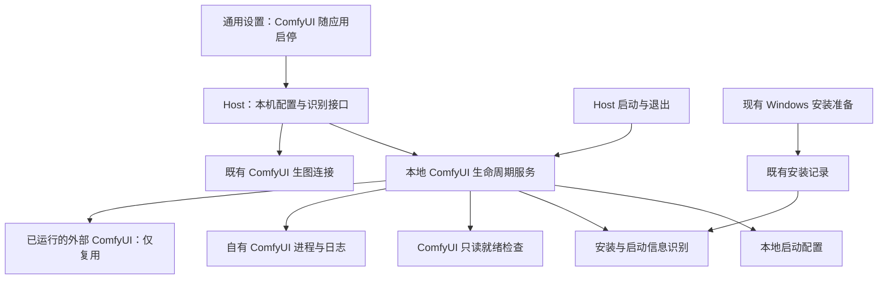
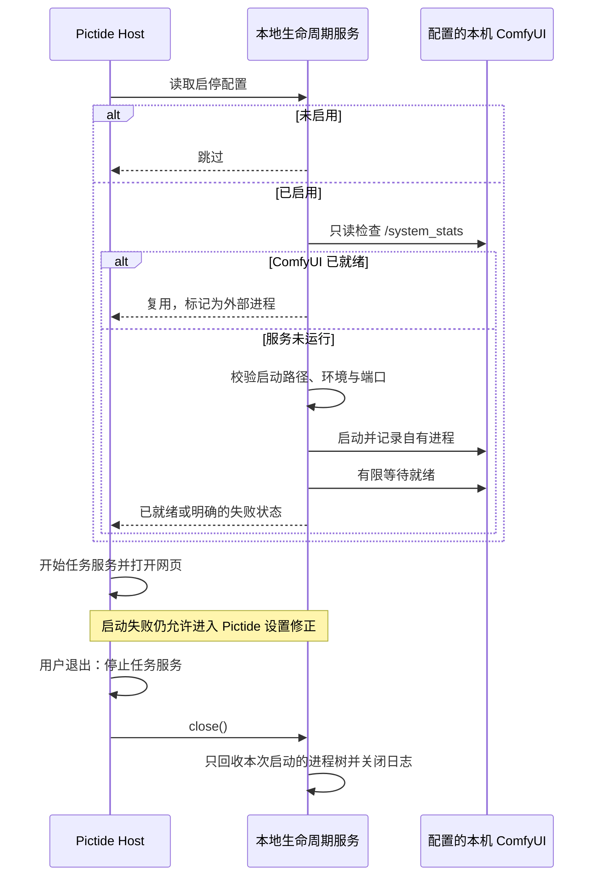

# ComfyUI 随 Pictide 启停

## 概述

提供可选的本机 ComfyUI 随 Pictide 启停功能，支持指定安装路径或自动识别；启动时复用已运行的服务，退出时仅回收本次由 Pictide 启动的进程。

状态：用户已确认设计，功能已实现并通过 Windows 隔离验证；本机现有 Comfy Desktop 的自动识别已只读实测。

## 架构

## 职责边界

| 组成 | 接口与职责 |
| --- | --- |
| 网页设置 | 在通用设置增加「ComfyUI 随应用启停」区域：开关、关联的 ComfyUI 生图 API、安装路径、「自动识别」、运行状态。Python、工作目录与参数放在高级配置中。识别结果供用户查看并保存；配置保存后下次启动生效，保存本身不启动或停止进程。 |
| Host | 组合生命周期服务，并在 Task 开始恢复和提交任务前完成 ComfyUI 启动尝试；先停止应用与任务，再关闭自有 ComfyUI。继续沿用现有桌面托盘、CLI 与更新重启入口，不把系统进程职责放入 Candidate、Recommendation、Task 或生图协议适配器。 |
| 本地生命周期服务 | 对外提供配置读取、校验保存、只读识别、启动和关闭。复用现有受管进程的环境隔离、Windows Job Object、就绪检查与滚动日志；区分「本次启动」「复用外部服务」「未运行」「启动失败」。一份 Pictide 数据目录配置一个跟随启动的本机服务。 |
| 安装识别 | 优先读取 Pictide 已有安装记录，再核对选定本机连接对应的运行信息及可验证的安装记录。识别便携 Python、虚拟环境与 Comfy Desktop 安装布局，取得 Python、入口文件、工作目录、模型等启动参数。多个候选交给用户选择；信息不足时保留手动配置。只读识别不启动、安装、升级或修改 ComfyUI。 |
| 生图连接 | 使用已有 ComfyUI API 的地址和工作流；关联必须是本机服务。启动监听地址与端口须匹配连接配置，端口冲突时说明原因。用户已有安装的模型、输入输出目录及工作流继续由原环境管理；Pictide 安装的环境继续沿用现有额外模型路径与自动接入逻辑。 |
| 配置存储 | 新配置放在所选数据目录的 `runtime/comfyui-lifecycle.json`，保存 `enabled`、`backend_id` 以及安装和启动信息；使用既有原子文件写入模式。安装器的 `local-generation.json` 继续保存安装状态，避免与网页配置互相覆盖。旧的 Pictide 受管安装在没有新配置时保持原有启动行为；其他已有用户默认关闭。 |

已增加的 HTTP 接口：

- `GET /api/settings/local-generation`：返回已保存配置、支持情况和本次会话状态。
- `PUT /api/settings/local-generation`：保存并校验启停配置，保留独立的安装记录；不触发生图或隐式重启。
- `POST /api/settings/local-generation/detect`：按关联连接和可选路径执行只读识别，返回候选启动信息。

启动配置与识别仅允许通过运行 Pictide 的电脑的 localhost 地址访问，复用现有同源检查。局域网页面显示需在主机配置的说明。参数作为明确的参数列表传给目标 Python，避免拼接 shell 命令。

## 调用和数据流

## 重点关注

- 关闭浏览器页面仍沿用现有行为：Pictide 在托盘中运行；从托盘退出或结束 CLI 会话才触发进程回收。
- 启动检测以配置地址上可识别的 ComfyUI 服务为准，不以同名 Python 进程或单纯端口开放为准。启动失败、超时或端口被其他程序占用要显示原因和日志位置，保留进入设置的能力。
- 已经运行的 ComfyUI 保持原有进程归属，不因 Pictide 退出而结束。不根据保存的旧 PID 杀进程。
- 自动识别保留有依据的 Python、工作目录、模型路径和输入输出参数；本机现有 Comfy Desktop 的启动方式已只读核对。识别信息在保存前可审阅。
- Windows 复用 Job Object；macOS/Linux 的 Python 环境按平台处理进程组与正常退出清理。安装布局无法可靠识别时提示手动配置，不执行猜测命令。
- 验证覆盖：关闭功能、复用外部服务、启动与退出自有进程树、无关进程保留、重复启动、无效路径、中文/空格路径、端口冲突、启动失败与超时、旧受管安装兼容，以及桌面/手机设置交互。自动化使用临时目录、模拟服务和轻量子进程，不提交真实图片任务；平台未实测部分单独记录。
- 交付更新架构、接口、数据布局及用户说明，按已有授权提交和推送 GitHub；本次不自动创建新版本 Release。

参考：现有 `backend/setup/local_generation_session.py` 与 `backend/host.py`；[ComfyUI 便携版布局](https://docs.comfy.org/installation/comfyui_portable_windows)、[手动安装与启动](https://docs.comfy.org/installation/manual_install)、[ComfyUI 就绪与启动参数信息](https://github.com/Comfy-Org/ComfyUI/blob/master/server.py)。

## 验证记录

- 后端定向检查 33 项：32 项通过，1 项 Unix 专属地址复用检查在 Windows 跳过。覆盖真实轻量子进程、进程树回收、外部服务保留、启动取消/失败/超时、旧受管安装、配置修复和本机访问限制。
- 核心烟测 12 项、前端单元 32 项、类型检查与隔离构建通过。
- 浏览器定向检查 13 项通过，包括新增设置的桌面/手机交互、中文深色与键盘操作、44 像素触控区域、多个安装选择、未保存草稿、失败提示，以及既有布局和更新流程。新增设置区后同步更新既有行数基线，并保留原有对齐断言；已目视检查手机与桌面截图。
- 本机 Comfy Desktop 识别出一个安装，已核对 Python、工作目录、模型路径和输入输出目录。只读发现与自动化检查均未提交真实图片任务，也未停止或修改用户现有 ComfyUI。
- macOS/Linux 的进程组实现尚未在对应系统原生实测；模拟服务验证不代表所有 ComfyUI 发行形态或 GPU 环境已验证。本次不创建应用 tag 或 Release。
