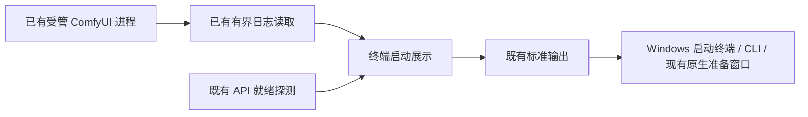
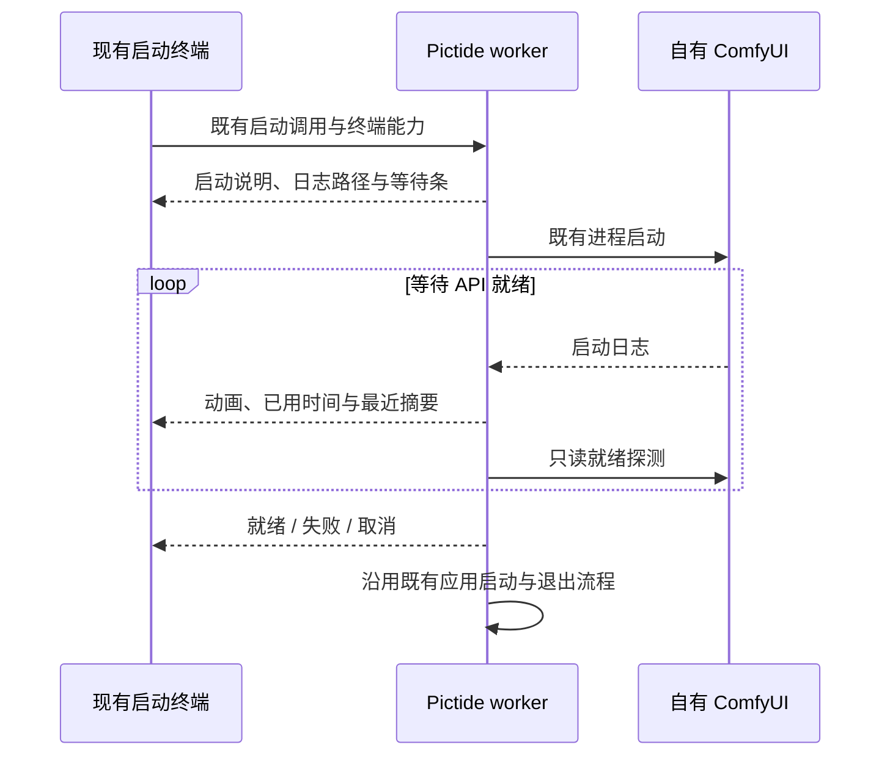

# ComfyUI 启动等待展示

## 概述

沿用已有启动终端和标准输出交接，在等待 ComfyUI 就绪时展示动态等待条、真实耗时和最近启动日志。

状态：已实现；沿用已确认的本地启停架构，本次属于终端展示与内部实现调整。

## 架构

## 职责边界

- `backend/desktop/startup_progress.py` 负责等待条、耗时、中文宽度截断和日志摘要呈现，复用现有日志脱敏。等待条为来回移动的动画，服务就绪探测成功后显示完成。
- `backend/desktop/launcher.py` 将真实终端能力与初始宽度传给隐藏 worker，继续沿用原来的 stdout 转发与就绪标记；重定向输出使用节流的普通文本。
- `backend/setup/comfy_process.py` 在既有进程启动与探测循环内更新展示，保留启动日志、超时、取消和进程树回收职责。展示变量不传给外部 ComfyUI。
- 现有 Host、配置和业务 HTTP 接口沿用原有职责与启动顺序。

## 调用和数据流

## 重点关注

- 使用实际经过的分钟与秒显示耗时；启动阶段没有可靠的总完成量，不据此推算完成百分比。
- 无新依赖；中文/英文按现有系统语言规则显示，近期日志移除终端控制字符并沿用脱敏规则。
- 真实 Windows PTY 已检查中文动画、耗时和完成行；隐藏 worker 与父进程使用实际管道完成就绪交接验证。自动化使用延迟的轻量 HTTP 服务，不启动真实 ComfyUI 或创建图片任务。
- 一并更新上次受管进程提取后遗留的日志测试导入/注入位置及模拟就绪数据，保留原有日志轮转、输出关闭断言。
- 本机源码更新后下次启动生效；保留当前运行中的 Pictide 与 ComfyUI。本次不创建 tag 或 Release。

## 验证记录

- 启动、终端、日志和启停定向检查 45 项：44 项通过，1 项 Unix 地址复用检查在 Windows 跳过。核心烟测 12 项通过。
- Windows 原生 PTY 已运行三秒模拟展示，确认中文动画、真实经过时间和完成行；实际隐藏 worker、父终端输出转发与服务存活通过轻量服务检查。
- 当前源码实例保持运行；本次更新在下次启动生效。macOS/Linux 未原生实测；未启动真实 ComfyUI 或提交图片任务。
