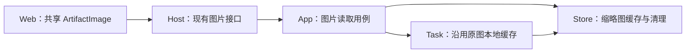
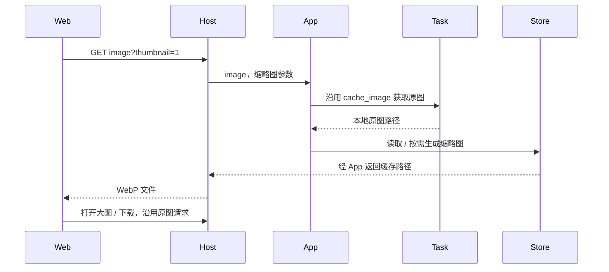

# 图片列表缩略图

## 概述

喜欢、生成和最近取消喜欢共用按需生成的 480px WebP 缩略图，大图与导出继续读取原图。

## 架构

## 职责边界

| 接口 / 模块 | 变化 |
| --- | --- |
| `GET /api/artifacts/{id}/image?thumbnail=1` | 在现有图片接口增加缩略图读取参数；未带此参数的大图以及 `download=1` 保持原图语义。 |
| App 的图片读取用例 | 获取既有原图路径后，按参数选择原图或 Store 缩略图缓存，不修改任务、反馈和数据库结构。 |
| Store 的缩略图缓存 | 长边不超过 480px、不放大，保持比例、透明度与 EXIF 方向，输出 WebP。缓存位于 `data/cache/thumbnails/`，首次访问生成，随后复用；并发请求合并并限制同时转换数量。 |
| Store 的图片清理 | 复用原图删除队列，按图片 ID 删除对应缓存，防止清理与生成竞态留下缓存。 |

## 调用和数据流

## 重点关注

- 仅生成缩略图缓存，不预扫历史图片，不额外复制原图。
- 转换在线程中执行，关闭应用时收尾；原图被删除后不得重新写回缩略图。
- 原图更新时重建缓存；图片和缓存目录的读取、删除沿用既有路径边界。
- 动图使用静态首帧预览，完整图片与导出仍使用原文件。
- 使用临时图片和模拟生图服务验证尺寸、缓存复用、并发、清理、方向、透明度和浏览器请求。

## 验收记录

- 接口方案已确认，沿用既有图片读取和清理边界，无数据库迁移。
- 缓存专项 10 项检查通过，覆盖原图与元数据保持、缓存复用和更新、方向与透明度、静态首帧、并发限制、断开、关闭和清理竞态。
- HTTP 专项 4 项、核心 19 项检查通过；67 项相关回归中 66 项通过，1 项平台检查跳过。缩略图明确返回 WebP 类型并支持私有缓存和 304，其他接口保留默认 no-store。
- 桌面、手机的缩略图、喜欢恢复和导出共 10 条页面流程通过；缓存响应调整后另复查两条缩略图流程，均通过。
- 类型检查与隔离前端构建通过。验证使用临时图片、模拟服务及现有 Pillow，不调用真实生图服务。
