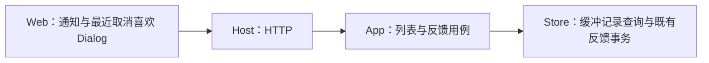
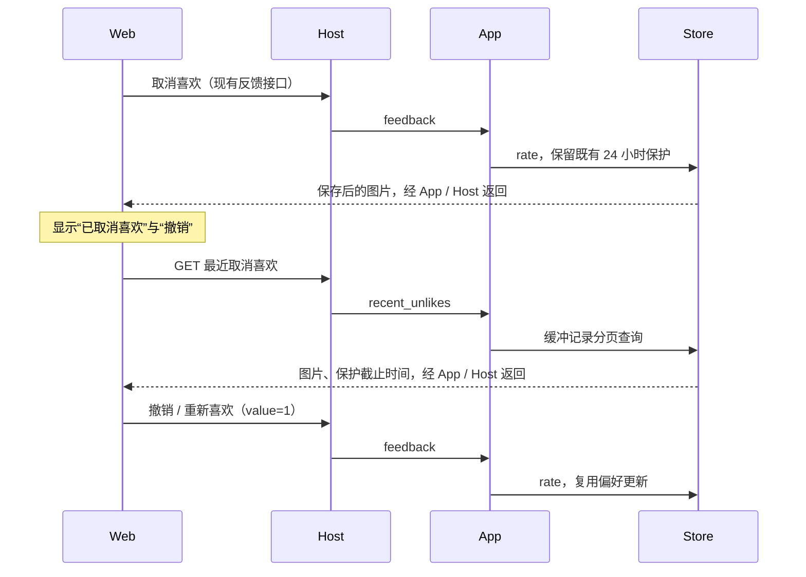

# 喜欢图片恢复

## 概述

采用已选定的工具栏入口方案：喜欢页在毛玻璃、多选导出之后增加“最近取消喜欢”，取消后提供“撤销”，并能在缓冲期内重新喜欢。

## 架构

沿用现有职责边界，复用共享 Dialog、图片网格、大图查看器和通知。

## 职责边界

| 接口 | 变化 |
| --- | --- |
| `GET /api/liked/recently-unliked?limit=100&before=...` | 新增只读分页列表，返回仍在 24 小时缓冲期内、未被物理清理且当前未喜欢的图片。按取消时间从新到旧排列；响应沿用图片窗口结构，并提供服务端时间与已有保护截止时间。 |
| `PUT /api/artifacts/{id}/feedback`，`{value:1}` | 复用现有恢复和学习路径，供“撤销”和“重新喜欢”调用，不增加恢复专用写接口。 |
| App → Storage | 增加最近取消喜欢的分页读取；反馈继续使用既有 `rate`。 |

使用已有 `unliked_protected_until` 和反馈记录，不增加数据列。恢复后从最近取消列表移除，重新出现在喜欢列表中。

## 调用和数据流

## 重点关注

- 保留现有取消喜欢确认；撤销使用共享通知操作。
- 入口不受当前喜欢筛选、排序或是否已有喜欢图片限制；关闭弹窗保留原列表位置与筛选。
- 最近列表复用喜欢页毛玻璃状态；未恢复的图片不提供原图下载。
- 截止时间表示恢复入口的保护窗口，不表述为到时立即删除。
- 覆盖刷新、重新启动、分页、跨页面反馈、弹窗空状态以及桌面和手机操作。
- 开发与检查使用临时数据和模拟生图，保护正在运行的实例。

## 验收记录

- 工具栏入口与新增只读接口均已确认；实现复用现有反馈事务，无数据迁移。
- 后端 64 项检查：63 项通过，1 项平台检查跳过；覆盖缓冲期、隐藏图片、恢复、稳定分页及既有清理、导出、桌面和网络流程。
- 前端 7 项单元检查通过；4 条新增恢复流程及 4 条既有首次使用流程通过，覆盖 1365px、390px、320px、英文深色主题、长列表与非对称安全区域。
- 类型检查、隔离产物构建与差异检查通过。检查仅使用临时数据和模拟生图服务。
