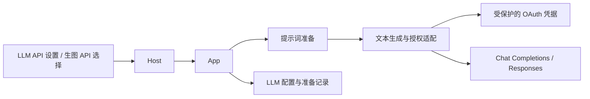
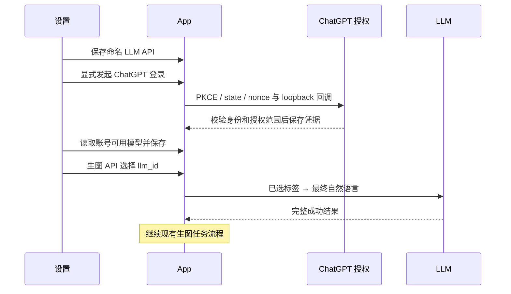

# 独立 LLM API 与 ChatGPT 接入

## 概述

按已确认的交互，将 LLM API 独立为设置分区；生图 API 选择保存的 LLM 配置。支持 API Key 和 ChatGPT 官方登录两条文本生成路径。

## 架构

## 职责边界

- Host 提供 LLM 配置 CRUD、显式登录/断开和模型读取；登录只允许在运行 Pictide 的电脑上通过本机地址触发。
- App 解析生图 API 的 `llm_id`，协调配置保存、引用检查及准备结果失效。
- Prompting 处理文本协议和 OAuth 生命周期。候选、推荐和生图任务的职责不变。
- Store 保留命名配置；OAuth 凭据独立保存，Windows 用 DPAPI，macOS/Linux 限定文件所有者访问。

## 调用和数据流

## 重点关注

- 旧单例迁移为 `legacy-prompt-api`，保留密钥与 revision；旧图片和反馈不改写。
- 不自动切换付费路径；不把 OAuth token 或文本 API 密钥返回网页。
- 使用中的配置不能删除；断开保留注册身份，重新授权复用 client ID。
- Responses 仅在收到 `response.completed` 时接受结果；中断和额度错误不自动重复生图。
- 自动验证使用临时数据和模拟服务；真实账号授权与额度可用性需单独确认。
