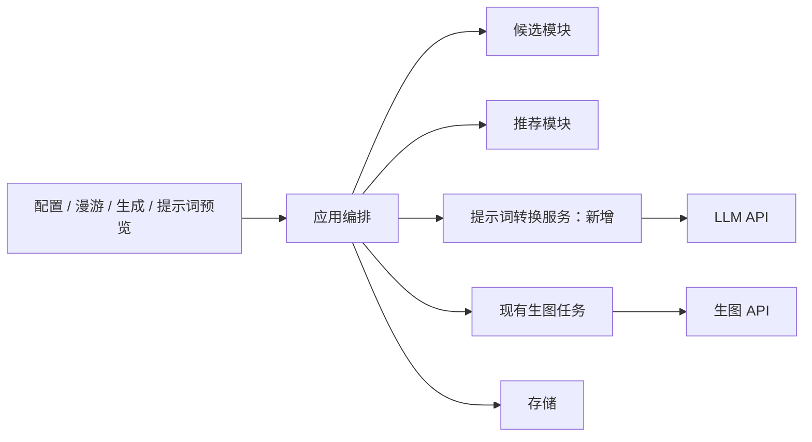
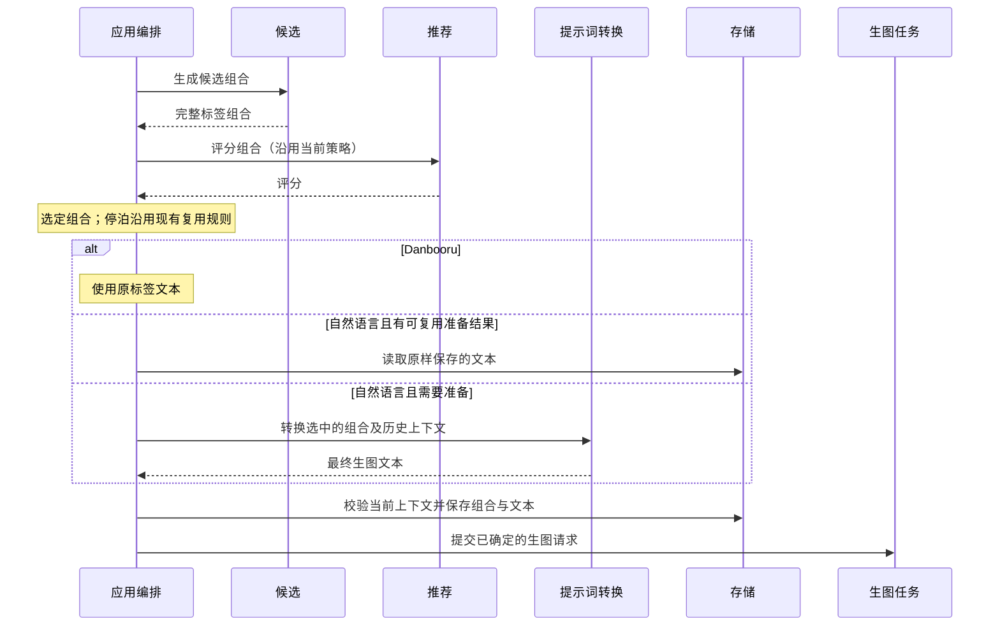

# 自然语言生图提示词

## 概述

保留候选与推荐链路，由编排层将选中的标签组合经 LLM 转成自然语言，再交给生图服务；提示词类型由每个生图 API 配置选择。

状态：用户确认后已实现首版并完成本地验证，尚未发布。采用独立的 OpenAI-compatible Chat Completions 文本服务；自然语言提示词只读。当前通过模拟服务验证流程，真实 LLM 的语义保真和顺流句式稳定性尚未实测。

首版范围：自然语言提示词由标签组合自动生成，只读展示。用户继续通过标签、锚点和预设引导画面；本版不提供自然语言编辑、用户主干输入或相应的标签同步与冲突确认流程。

## 架构

## 职责边界

| 组成 | 职责及接口变化 |
| --- | --- |
| 生图 API 配置 | 增加 `prompt_type: danbooru / natural_language`，旧配置默认 `danbooru`；类型按具体配置选择，与 API 协议无关 |
| LLM 配置 | 首版建议共用一套文本服务配置：地址、密钥、模型；只在自然语言模式下需要。生图 API 与 LLM 的凭据分别保存，复用现有网络和密钥处理机制 |
| 候选 / 推荐 | 继续生成、评分标签组合；算法和评分输入不变，不调用 LLM |
| 提示词转换服务 | 输入选中的完整组合、正负向词、模式、可用的历史文本及生图能力，输出确定的正负向生图文本；不选候选、不调用生图 API、不直接读写数据库 |
| 应用编排 | 选择组合、决定复用或转换、保存准备结果，然后提交现有生图任务；拥有取消、过期检查、准备状态与串行依赖 |
| 生图任务 | 接收已确定的文本，沿用已有提交、恢复和结果关联机制；不自行调用 LLM |
| 存储 | 分别保存候选语义快照和实际发送的提示词，绑定到同一次准备结果及任务；读取历史记录时兼容旧数据 |
| 前端 | 只读展示标签、实际文本和准备状态；不提供自然语言编辑，不在浏览器内拼接转换规则或调用 LLM |

转换服务位于 `backend/prompting/`，使用 Chat Completions JSON object 输出。`backend/prompt_preparation.py` 属于编排层，负责串行转换、复用与配置校验；`backend/store/prompting.py` 保存配置和准备记录。没有增加供应商注册框架或运行时依赖。

转换请求必须包含固定词、锚点和候选元素，要求忠实表达其含义，不擅自增加主要对象或改写用户意图。顺流转换另带前后组合和已生成文本；转换返回非空、长度受限的结构化结果。结构校验不能保证语义完全忠实，需用真实模型样例验证。

## 调用和数据流

### 三种漫游模式

| 模式 | 自然语言处理 |
| --- | --- |
| 漂流 `random` | 每个新组合可重新组织文本结构，只转换最终选中的一个组合 |
| 顺流 `along` | 将上一份文本、旧组合、新组合及元素变化交给 LLM，要求保留句式、顺序和未变化部分，尽量只修改变化元素 |
| 停泊 `stay` | 原样复用已确定的正负向文本，不调用 LLM；沿用当前生图能力允许的随机性生成新图片 |

顺流首张没有可用历史文本时，先生成一份作为后续参考。连续预取使用同一条参考链：上一份文本准备完成并保存后，下一份才能基于它转换；参考不能只是当前屏幕上还未切换的旧图。沿用现有缓冲限制，不把整个候选池送给 LLM。

停泊进入时已有兼容自然语言文本就直接复用。首次使用自然语言且没有可复用文本时，需要一次初始化转换，此后停泊不再调用 LLM。切换生图 API、提示词类型或修改元素，视为开始新的准备上下文，不能继续使用不匹配的文本。

### 提示词预览与生成

- 自然语言预览同时展示「标签组合」和只读的「生图提示词」，支持复制；锚点面板继续用于编辑标签，不提供自然语言编辑框。Danbooru 维持当前展示。
- 提示词页候选预览没有绑定生图服务时，需要先选择目标生图 API，才能确定提示词类型；仅浏览标签不触发 LLM。
- 用户主动请求自然语言预览时转换一次，显示准备进度；切换页签、重新展开面板、读取历史图片不触发转换。
- 预览结果绑定候选快照与配置版本。由该预览继续生成时复用同一份文本；修改标签、预设或相关服务配置后，旧结果标为过期，下一次生成请求才重新准备。
- 漫游自动生成和生成页也走同一准备接口。生成页同一组合的多张图片共用文本，仅按原有规则改变种子；新组合分别转换。
- 图片信息展示该图实际使用的文本；标签展示、锚点和推荐学习仍使用历史标签快照。

## 重点关注

### 语义快照与实际文本分开

现有实现把任务文本视作标签拼接，这些读取点必须一并调整：

- `backend/application.py` 中的图片评分校验：以不可变候选快照校验标签，以同次准备结果关联实际文本，不取消一致性检查。
- `backend/store/sqlite.py` 的 `roam_prompt_reference`：候选模块获得标签组合，转换服务获得对应自然语言文本，不把自然语言送入标签解析。
- `liked_positive_prompts`、`liked_tags` 及其调用方：从历史语义快照获取标签，避免按逗号拆分自然语言。
- 反馈、喜欢词池、锚点及历史预览：沿用同一语义来源；旧 Danbooru 数据保留兼容读取，历史图片不重新转换。

推荐学习的是用户对这组元素的反馈。LLM 改写偏离标签会引入额外学习噪声；不能通过复用算法就假定真实图片质量与偏好效果不受影响。

### 准备、取消与重试

转换作为编排层的异步准备阶段，向前端报告「正在准备提示词」，成功后进入现有生图任务。全局串行调用文本服务，生成请求串行准备整批，漫游轮询复用当前准备任务；提交前检查现有队列容量，不提前创建占位生图任务。

同一请求 ID 复用保留的准备结果；成功文本先保存再提交生图，已提交批次沿用原有幂等记录。准备表保留最近 500 条，过期预览报冲突，未提交的旧请求可能需要重新转换。LLM 超时或失败时停止本次流程，通过已有悬浮通知展示错误，不静默切回标签、不无限重试。结果未知的 LLM 请求仅由用户明确重试，不能承诺服务端未产生费用。

等待转换期间允许切换设置，提交生图前再次核对配置版本与漫游 epoch；首版没有独立的转换取消按钮。应用退出时停止漫游准备；浏览器断开不能保证远端请求终止。重启恢复优先使用已保存文本，已发出但没有结果的自动转换会暂停，需明确保存漫游设置后再试。生成页重试会保留已选的批次和已成功转换的轮次。

### 负向词与外部服务

候选语义快照始终保留原正负向词。支持负向通道的生图配置分别转换正负文本；不支持的配置，建议将避免事项作为约束融入正向描述，负向字段留空。这是提示方式转换，不代表模型一定遵守排除条件，应在测试中单独验证。

自然语言模式会把选中的标签、固定词及顺流所需的上一份提示词发送给用户配置的 LLM；无需发送图片或完整反馈历史。设置说明应简短说明这个额外服务用途。

### 验证范围

- 自然语言文本只读且可复制，无手动编辑或用户参考文本入口；标签和锚点仍可按原有方式编辑。
- 默认和旧配置保持 Danbooru，LLM 调用次数为零。
- 自然语言只转换被选中的组合；标签评分和反馈仍能执行，喜欢词池不混入自然语言句子。
- 顺流传入正确的前后组合及文本，连续预取链有序；真实模型测试结构稳定性与元素保真度。
- 停泊有参考文本时调用次数为零；首份初始化、模式切换和配置失效各有覆盖。
- 预览到生图文本一致，多图复用、失败重试、取消和重启不会意外重复转换或提交过期结果。
- 正负向能力不同的生图 API、旧历史记录兼容、桌面与移动预览布局均有定向验证；错误通知不挤占页面布局。

模拟服务验证流程与调用次数；真实 LLM 和生图样例用于判断改写质量，不以模拟通过替代效果验证。

实现采用原有表单、折叠区、复制字段与右上角通知。桌面和手机预览均显示标签及只读自然语言文本；提示词页每次独立预览不继承上一份自然语言文本，漫游顺流和生成页单次批量 sequence 才使用连续文本参考。英文使用说明与架构/API 文档已同步更新，中文用户文档按翻译策略留待集中更新。

本地验证：自然语言后端 11 项、既有应用 HTTP 10 项、核心冒烟 8 项、前端单元 29 项、浏览器流程 22 项通过；另覆盖漫游模式、锚点、喜欢词筛选、图片评分和标签快照回归。类型检查与前端构建通过，构建保留现有大 chunk 提示。验证使用隔离数据和模拟服务，没有调用真实收费 API、生图模型或修改用户运行数据。
