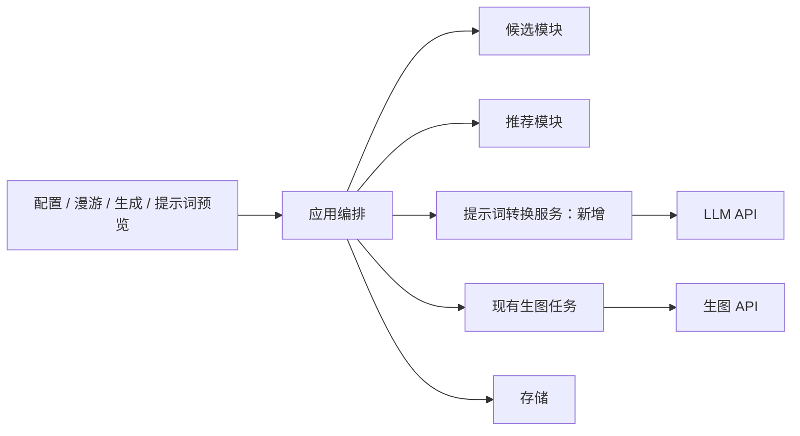
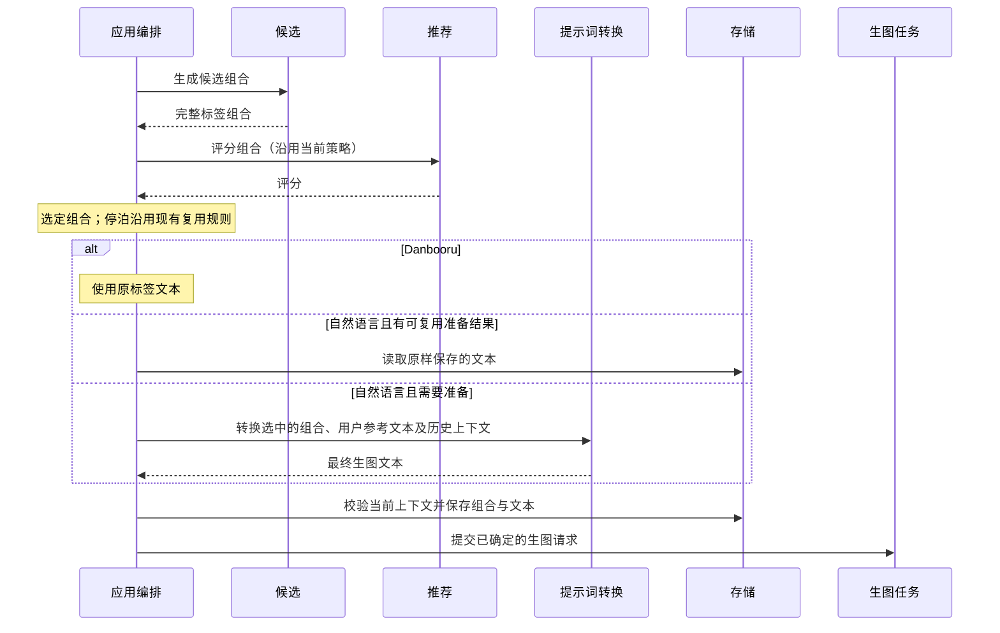

# 自然语言生图提示词

## 概述

保留候选与推荐链路，由编排层将选中的标签组合经 LLM 转成自然语言，再交给生图服务；提示词类型由每个生图 API 配置选择。

状态：设计草案。用户已明确主流程和三种漫游模式；下述新增接口、LLM 配置和准备阶段行为待确认，尚未实现。

## 架构

## 职责边界

| 组成 | 职责及接口变化 |
| --- | --- |
| 生图 API 配置 | 增加 `prompt_type: danbooru / natural_language`，旧配置默认 `danbooru`；类型按具体配置选择，与 API 协议无关 |
| LLM 配置 | 首版建议共用一套文本服务配置：地址、密钥、模型；只在自然语言模式下需要。生图 API 与 LLM 的凭据分别保存，复用现有网络和密钥处理机制 |
| 候选 / 推荐 | 继续生成、评分标签组合；算法和评分输入不变，不调用 LLM |
| 提示词转换服务 | 输入选中的完整组合、正负向词、模式、用户保存的参考提示词、可用的历史文本及生图能力，输出确定的正负向生图文本；不选候选、不调用生图 API、不直接读写数据库 |
| 应用编排 | 选择组合、决定复用或转换、保存准备结果，然后提交现有生图任务；拥有取消、过期检查、准备状态与串行依赖 |
| 生图任务 | 接收已确定的文本，沿用已有提交、恢复和结果关联机制；不自行调用 LLM |
| 存储 | 分别保存候选语义快照、用户参考文本及其版本和实际发送的提示词，绑定到同一次准备结果及任务；读取历史记录时兼容旧数据 |
| 前端 | 展示标签、实际文本和准备状态；自然语言模式的锚点面板提供文本编辑与保存，不在浏览器内拼接转换规则或调用 LLM |

建议转换服务放在 `backend/prompting/`，内部封装一个文本 API 适配器。首版建议采用 OpenAI-compatible 文本接口，不提前建设多供应商注册框架；具体协议在实现前确认。

转换请求必须包含固定词、锚点和候选元素，要求忠实表达其含义，不擅自增加主要对象或改写用户意图。顺流转换另带前后组合和已生成文本；转换返回非空、长度受限的结构化结果。结构校验不能保证语义完全忠实，需用真实模型样例验证。

## 调用和数据流

### 三种漫游模式

| 模式 | 自然语言处理 |
| --- | --- |
| 漂流 `random` | 每个新组合可重新组织文本结构，只转换最终选中的一个组合 |
| 顺流 `along` | 将上一份文本、旧组合、新组合及元素变化交给 LLM，要求保留句式、顺序和未变化部分，尽量只修改变化元素 |
| 停泊 `stay` | 原样复用已确定的正负向文本，不调用 LLM；沿用当前生图能力允许的随机性生成新图片 |

顺流首张没有可用历史文本时，先生成一份作为后续参考。连续预取使用同一条参考链：上一份文本准备完成并保存后，下一份才能基于它转换；参考不能只是当前屏幕上还未切换的旧图。沿用现有缓冲限制，不把整个候选池送给 LLM。

停泊进入时已有兼容自然语言文本就直接复用。首次使用自然语言且没有可复用文本、也没有用户保存文本时，需要一次初始化转换，此后停泊不再调用 LLM。切换生图 API、提示词类型或修改元素，视为开始新的准备上下文，不能继续使用不匹配的文本。

### 在锚点面板编辑自然语言

自然语言模式下，展开锚点面板后，在标签区域下方提供「提示词」多行编辑框，默认载入当前图片实际使用的自然语言提示词。用户可以修改并保存，保存后作为后续生成的用户参考文本；已有图片及其历史文本保持不变。普通模式与沉浸模式复用同一编辑组件。

- 编辑过程只更新草稿；明确保存后生效，不在每次输入时调用 LLM。关闭面板或图片切换不覆盖未保存草稿；保存状态与当前图片文本来源要可辨认。
- 用户参考文本与上一份自动生成文本分别保存。后续 LLM 输出不能覆盖用户参考文本；用户可以清除参考，恢复只根据标签和漫游历史生成。
- 漂流：参考用户文本中的意图、风格和表达，允许为新组合重新组织结构。
- 顺流：首次应用手改内容时以用户文本为改写基准；后续使用上一份生成文本、元素变化和持续保留的用户参考，尽量保留结构。用户再次保存文本时更新基准。
- 停泊：用户保存后，后续生图原样使用新文本，不调用 LLM。手改是用户主动替换停泊文本，不属于自动改写。
- 保存或清除参考时更新上下文版本，使旧预览与待展示的旧预取结果失效；已发出的请求遵循现有取消能力，其迟到结果不能重新进入当前漫游队列。

转换服务必须区分「用户参考」和「自动生成历史」。明确锚点及固定词继续作为约束，用户参考优先于自动生成历史中的措辞；对于未锁定的元素，参考文本不能把其隐式变成永久锚点。参考文本与显式约束发生冲突时，保留显式约束并在改写中协调表达。首版不额外调用 LLM 反向抽取标签，也不自动修改用户选定的锚点。

### 提示词预览与生成

- 自然语言预览同时展示「标签组合」和「生图提示词」；Danbooru 维持当前展示。
- 提示词页候选预览没有绑定生图服务时，需要先选择目标生图 API，才能确定提示词类型；仅浏览标签不触发 LLM。
- 用户主动请求自然语言预览时转换一次，显示准备进度；切换页签、重新展开面板、读取历史图片不触发转换。
- 预览结果绑定候选快照、用户参考版本与配置版本。由该预览继续生成时复用同一份文本；修改标签、预设、用户参考或相关服务配置后，旧结果标为过期，下一次生成请求才重新准备。
- 漫游自动生成和生成页也走同一准备接口。生成页同一组合的多张图片共用文本，仅按原有规则改变种子；新组合分别转换。
- 图片信息展示该图实际使用的文本；标签展示、锚点和推荐学习仍使用历史标签快照。

## 重点关注

### 语义快照与实际文本分开

现有实现把任务文本视作标签拼接，这些读取点必须一并调整：

- `backend/application.py` 中的图片评分校验：以不可变候选快照校验标签，以同次准备结果关联实际文本，不取消一致性检查。
- `backend/store/sqlite.py` 的 `roam_prompt_reference`：候选模块获得标签组合，转换服务获得对应自然语言文本，不把自然语言送入标签解析。
- `liked_positive_prompts`、`liked_tags` 及其调用方：从历史语义快照获取标签，避免按逗号拆分自然语言。
- 反馈、喜欢词池、锚点及历史预览：沿用同一语义来源；旧 Danbooru 数据保留兼容读取，历史图片不重新转换。

推荐学习的是用户对这组元素的反馈。LLM 改写或用户自由编辑可能增加、删除标签快照未反映的元素，带来额外学习噪声；候选标签只能表明来源，不能据此声称完整描述了手改后的画面。保留用户编辑来源及实际文本用于验证这一局限，不能通过复用算法就假定真实图片质量与偏好效果不受影响。

### 准备、取消与重试

转换作为编排层的异步准备阶段，向前端报告「正在准备提示词」，成功后进入现有生图任务。准备也占用一次生成请求的排队名额，避免重复点击或轮询产生并发 LLM 请求。

同一请求 ID 只对应一次准备结果；成功文本先保存再提交生图，生图失败后重试复用文本。LLM 超时或失败时停止本次流程，通过已有悬浮通知展示错误，不静默切回标签、不无限重试。结果未知的 LLM 请求仅由用户明确重试，不能承诺服务端未产生费用。

等待转换期间允许切换设置或取消。提交生图前再次核对配置版本与漫游 epoch，过期结果不能进入新队列。重启恢复优先使用已保存文本；没有完整结果的准备请求进入可重试状态。

### 负向词与外部服务

候选语义快照始终保留原正负向词。支持负向通道的生图配置分别转换正负文本；不支持的配置，建议将避免事项作为约束融入正向描述，负向字段留空。这是提示方式转换，不代表模型一定遵守排除条件，应在测试中单独验证。

自然语言模式会把选中的标签、固定词、用户参考文本及顺流所需的上一份提示词发送给用户配置的 LLM；无需发送图片或完整反馈历史。设置说明应简短说明这个额外服务用途。

### 验证范围

- 默认和旧配置保持 Danbooru，LLM 调用次数为零。
- 自然语言只转换被选中的组合；标签评分和反馈仍能执行，喜欢词池不混入自然语言句子。
- 顺流传入正确的前后组合及文本，连续预取链有序；真实模型测试结构稳定性与元素保真度。
- 停泊有参考文本时调用次数为零；首份初始化、模式切换和配置失效各有覆盖。
- 锚点面板手改草稿不被图片切换覆盖；保存后转换请求包含正确的用户参考，自动结果不覆盖它；清除参考、版本失效和迟到预取结果有覆盖。
- 停泊手改后原样发送新文本且 LLM 调用为零；漂流与顺流分别验证用户参考的保留方式、显式锚点冲突和自由编辑导致的标签偏差。
- 预览到生图文本一致，多图复用、失败重试、取消和重启不会意外重复转换或提交过期结果。
- 正负向能力不同的生图 API、旧历史记录兼容、桌面与移动预览布局均有定向验证；错误通知不挤占页面布局。

模拟服务验证流程与调用次数；真实 LLM 和生图样例用于判断改写质量，不以模拟通过替代效果验证。
