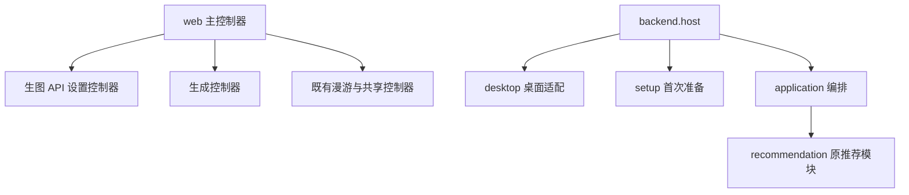
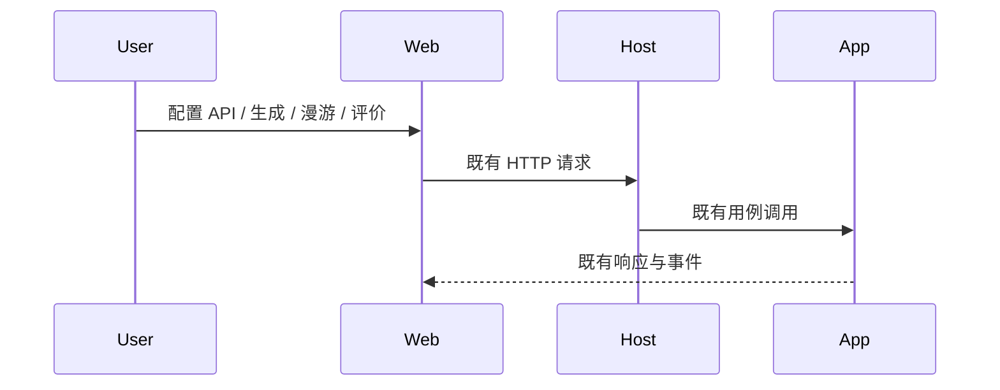

# 项目目录整理

## 概述

按已确认的职责归组源码与测试，拆出前端生图 API 设置和生成控制器，保留现有业务边界与运行数据布局。

## 架构

## 职责边界

- 前端仍使用同一入口、共享组件、HTTP/SSE 和已有状态；独立控制器负责自己的表单、草稿与事件，主控制器保留页面和跨栏目协调。
- `backend/desktop/` 归组桌面会话、启动、系统语言与 Windows 托盘；`backend/setup/` 归组环境与模型准备、Windows 引导与硬件检测。
- `recommand/` 更名为 `recommendation/`，推荐接口与算法保持原样。候选、推荐与任务仍通过 application 协作。
- 前端单元测试放 `web/tests/unit/`，浏览器测试保留 `web/tests/browser/`；Python 测试按 backend 业务、corpus 与 scripts 分类，统一使用包导入。

## 调用和数据流

## 重点关注

- 同步导入、测试入口、打包资源与文档路径；源码和冻结运行库分别检查模型清单、工作流与图标定位。
- 保留原始数据、历史资料和现有工作流；此次只整理受 Git 管理的源码。
- 验证类型、构建、少量核心/浏览器冒烟及受影响的桌面和打包用例；模拟检查与真实平台测试分别说明。
