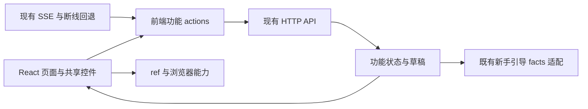
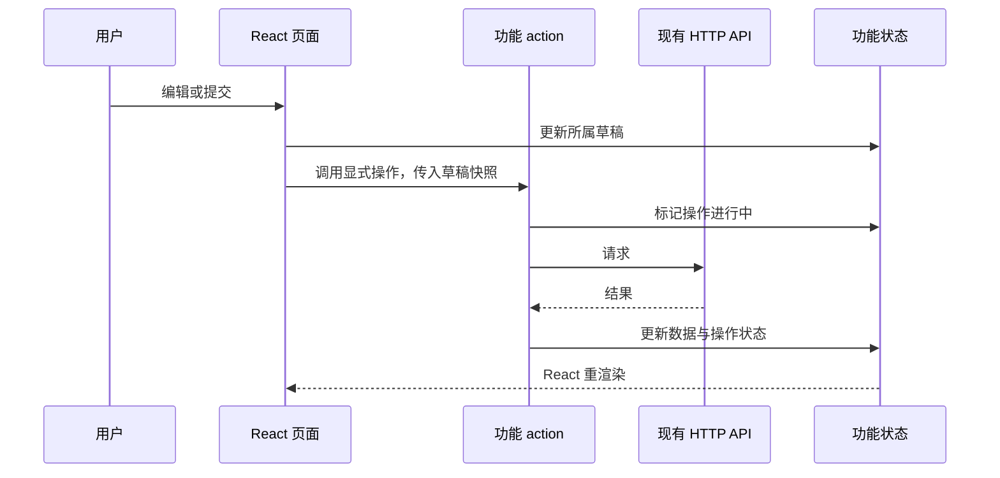

# 前端 DOM 桥接清理

## 概述

本次完整移除界面状态的 DOM 桥接，由 React 统一管理页面、表单和动态内容，不再等待后续功能修改。状态：待确认设计，尚未实施。

## 现状

- `control-bridge.tsx` 扫描整页控件、拦截原生属性，把隐藏控件转换为 React 控件；折叠区和弹窗还会搬移已有节点、改写查询方法及 `HTMLDialogElement.prototype`。
- `feed.tsx` 渲染外壳，`app.js` 再修改可见性、文字、按钮、表单和任务节点。两个系统共同拥有界面，React 重渲染可能覆盖控制器的修改。
- `generation-controller.js`、`backend-settings.js` 用 DOM 保存草稿；工作流选择、节点参数、生成表单和设置标签页仍依赖桥接。
- 已有 React 图片列表、漫游选项和编辑器通过 document 自定义事件传递业务状态与操作，调用关系不明确。
- `tag-picker.tsx` 的旧创建入口目前无外部调用，可直接删除；提示词编辑器本身已是 React，保留其业务实现。

## 架构

沿用 React、现有纯逻辑辅助函数、通知和引导机制。按功能拆分状态与操作，不引入新的状态管理依赖，也不建立映射 DOM 属性的兼容层。

## 职责边界

| 组成 | 职责与接口 |
| --- | --- |
| 应用入口 | 创建前端会话，管理启动、订阅及清理，通过 Context 向页面提供状态和 actions |
| 功能状态 | 漫游、生成、API 设置、任务与列表分别拥有自己的数据、草稿和进行中状态；提供快照与订阅，供 React 读取 |
| 功能 actions | 接收普通值，例如 `submitGeneration(draft)`、`saveBackend(draft)`、`setView(view)`；返回结果或 Promise，不读取隐藏控件，不构造展示节点 |
| React 页面 | 使用受控表单、显式回调和共享 Radix 控件呈现状态；草稿、折叠状态在既定所有者中保留，不因页面切换或后台刷新丢失 |
| 浏览器适配 | 通过显式 ref 处理焦点、测量、滚动、全屏、图片加载和触摸；保留真实浏览器事件与必要布局观察，移除用于同步业务状态的 DOM 观察 |
| 新手引导 | 沿用 `ui-state` facts 与 `ui-targets` 语义定位，业务操作确认成功后发布事实；引导步骤不进入业务组件 |

后端模块边界、HTTP/SSE 协议、推荐算法与持久化结构均沿用现有实现。

## 调用和数据流

SSE 和断线回退触发现有刷新逻辑，响应只更新相应服务数据，不覆盖正在编辑的草稿。请求 ID、未知提交的重试、竞态保护、反馈与撤回、漫游预取触发条件保持原有语义。

## 实施顺序

1. 建立显式前端会话和功能接口，接管导航、启动与订阅；统一销毁监听器、计时器和 SSE 连接。
2. 迁移生成表单和 API/工作流设置，包括节点参数、校验、草稿、按钮反馈和保存流程。
3. 迁移漫游展示、历史设置及任务列表，替换 React 组件间承载业务状态的 document 事件。
4. 删除 `ControlLayer`、属性拦截、隐藏代理控件、节点搬移、旧 DOM 展示辅助与无引用样式；更新英文开发文档。
5. 完成端到端验证后一起合入并部署；各阶段用于控制修改风险，不作为保留旧桥接的交付终点。

## 验收

- 应用不再导入 `control-bridge` 或通过 DOM 元素读写业务状态；界面节点由对应 React 组件拥有。
- 正常 DOM 操作仅用于浏览器能力，例如焦点、滚动、图片动画、剪贴板兼容及文件下载，不以删除所有 DOM API 为目标。
- 生成草稿切页不丢失；后台刷新不覆盖草稿；重复或未知提交维持相同请求 ID；预设切换、工作流导入与节点编辑保存正确。
- 漫游、喜欢、图片弹窗、沉浸模式、键盘与触摸反馈、新手引导和手动更新的未保存保护保持行为。
- 类型检查、构建、相关纯逻辑检查和现有浏览器流程通过；增加草稿/工作流的缺口检查。复查桌面、手机、沉浸及非零安全区截图。
- 浏览器模拟与真实 iOS PWA 验证分别报告；模拟生成不触发 GPU 或付费请求。

## 重点关注

最大风险是状态所有权转换时丢失草稿、重复订阅或改变异步操作顺序。迁移以这些行为测试为约束，避免同时调整视觉设计和产品交互。已有 API 数据、图片、模型与用户反馈不参与本次重构。
