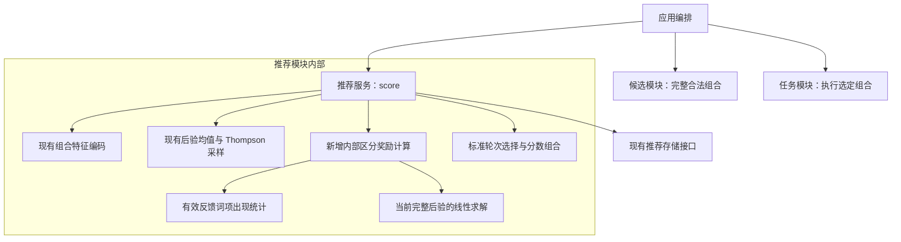
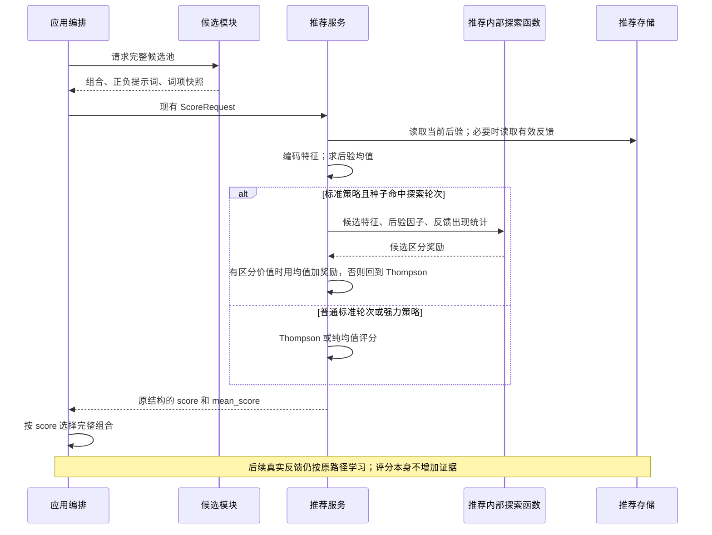

# 推荐模块内的标签区分探索

## 概述

推荐模块从已有完整候选中识别有助于区分混淆偏好的组合，在少量标准推荐轮次给予有上限的探索奖励。

状态：已确认并在源码实现，尚未部署或发布。仅调整推荐模块内部评分，不向候选模块传递探索约束。20% 与 0.2 保留为初始参数，离线对照尚未证明稳定优于原策略。

## 改动前基线

- [推荐架构](../../../dev/architecture/recommendation.md)：应用编排提交完整候选池，推荐返回每个组合的分数，编排选择最高分后提交任务。
- `RecommendationService.score()`：标准策略为 Thompson 采样，同一请求共享一组采样权重；强力策略为后验均值。
- `features.py`：正、负提示词通道分别编码；精确词项按通道 L2 归一化，另有共 768 维 MiniLM 语义特征。词项身份由规范化文本和通道决定。
- `policy.py`：已有完整精度矩阵 P 和反馈向量 b；先验为单位矩阵，反馈噪声方差固定为 1。通过 Cholesky 分解求均值和采样，不保存完整逆矩阵。
- `load_evidence()`：可读取每张图片当前有效的反馈及生成时词项快照；撤回不算负反馈，修改评价不增加独立样本。
- `mean_score` 用于图片偏好评分，`score` 用于本轮候选选择；两者已有独立含义。

## 架构

候选、推荐、任务之间的依赖保持现状。新逻辑仅是推荐模块内的函数与一次评分请求的中间数据，不增加服务、后台循环或数据库表。

## 职责边界

| 组成 | 职责与接口 |
| --- | --- |
| Candidate | 继续生成合法完整组合，处理 PMI、固定词、锚点和连续变化预算；不接收探索指令 |
| Application | 继续调用 `score(ScoreRequest)`、按 `CandidateScore.score` 选最高分；不识别标签对 |
| RecommendationService | 在同一后验快照上准备特征、读取有效证据、决定是否使用区分奖励，仍为所有输入候选返回分数 |
| 内部探索函数 | 接收当前词项索引、候选特征、反馈出现统计和 Cholesky 因子；返回每个候选的奖励值，范围为 0–1 |
| Store | 复用 `load_policy()`、`load_evidence()`、`get_reset_state()`；不增加公开接口和持久状态 |

建议把纯数值与筛选函数集中在 `backend/recommendation/exploration.py`，由 `service.py` 调用；`policy.py` 复用本轮 Cholesky 因子。不是新增领域模块或通用插件机制。

`ScoreRequest`、`ScoreResult`、HTTP、前端设置和任务接口均保持原结构。`mean_score` 始终为原始后验均值，不包含奖励。标准策略入口仍为 `strategy="thompson"`，新策略版本明确标识其内部包含少量区分探索；`strategy="mean"` 保持纯均值语义。

## 调用和数据流

### 1. 找到有区分必要的标签对

首版只以正向提示词中的精确词项为目标。正负评价都提供证据；负向提示词通道不参与目标配对，但仍参与完整后验与候选评分。

1. 从当前候选池提取正向词项，保留已经在有效评价中出现的词项。
2. 排除本轮所有候选都包含的词项：本轮没有移除它们的选择，常见原因是固定词或锚点。推荐不解析候选来源或自行修改提示词。
3. 按有效评价中的出现次数排序，最多保留 32 个词项；同次数按内容身份稳定排序。
4. 对这些词项组合成对，统计 `nAB`、`nA_only`、`nB_only`。每张当前有效评价的图片至多计一次，使用生成时快照。暂定共同出现至少 3 次后才进入定向探索。
5. 候选池中必须存在只包含 A 或只包含 B 的组合。没有可区分组合时，不要求候选模块重采样。

共同出现比例：

\[
J=\frac{n_{AB}}{n_{AB}+n_{A\_only}+n_{B\_only}}
\]

它只是混淆线索；真正的不确定性由完整后验判断。不同词项数量、重复次数与语义特征可能提供额外证据，不能只用共同出现次数判定已经混淆。

### 2. 同时评价共同贡献与贡献差异

令 `s=eA+eB`、`d=eA-eB`；`eA/eB` 在对应精确词项轴上为 1，其余为 0。这里比较标签权重，实际候选中各标签贡献仍乘其归一化特征值。

\[
V_+=s^\mathsf{T}P^{-1}s,\qquad V_-=d^\mathsf{T}P^{-1}d
\]

当前单位先验下，两者的初始方差都是 2。以此为参照，而不比较脱离尺度的绝对大小。

定义标签对的初筛优先级：

\[
Q=J\left(1-\frac{V_+}{2}\right)\frac{V_-}{2}
\]

- J 较高：历史上主要绑定出现。
- `1−V+/2` 较高：共同贡献相比先验已经学到较多。
- `V−/2` 较高：贡献差异仍保留较多不确定性。

有效模型下每个因子均在 0–1 之间；实现只对浮点舍入作边界裁剪。最多保留 Q 最高的 8 对，Q 为零时不进入探索。它是启发式优先级，不是“混淆的概率”或严格的最优实验设计。

不以差值均值接近零为必要条件：本方案要减少未来评分中的权重差异不确定性，并不只判断哪个标签排名更高。候选范围限制了本轮相关性；明显已经确定的差异会因 `V−/2` 较小而降低优先级。

### 3. 计算完整候选的区分价值

对每个保留的标签对 p 和完整候选特征 x：

\[
\Delta_{p,x}=\frac{(d_p^\mathsf{T}P^{-1}x)^2}{1+x^\mathsf{T}P^{-1}x}
\]

这是当前固定噪声高斯模型下，收到该候选的一次有效反馈后，差值方差的减少量；未评价不会更新后验。

计算包含所有精确词项、正负通道和语义维度，不仅取 A、B 的二阶精度子矩阵求逆。其他元素对反馈的干扰会进入分母及协方差计算。共同出现的候选不被硬性扣分：若完整特征确实能提供区分信息，仍按计算结果处理。

把减少量换成当前差值方差的减少比例：

\[
g_{p,x}=\frac{\Delta_{p,x}}{V_{-,p}}
\]

候选奖励取其最有价值的一对：

\[
I_x=\max_{p}(Q_p g_{p,x})
\]

`I` 范围为 0–1。取最大值，不累计多个重叠对子，避免奖励随标签对数量增加。没有有效标签对时全部为零；本轮所有候选奖励相同时，探索不会带来区分优势，回到 Thompson。

### 4. 与现有探索协调

标准模式初始实现：

- 80% 轮次沿用原 Thompson 评分。
- 20% 轮次尝试区分探索；有有效奖励时使用 `score=mean_score+0.2×I`，不再叠加本轮 Thompson 随机项。
- 无有效证据、候选不可区分或奖励相同时，沿用原 Thompson 评分。

轮次选择从现有 `sampling_seed` 派生独立随机流，不消耗原 Thompson 采样流；同一状态、候选和种子下可复现。不增加按时间触发的探索，也不记录一次评分为一次观察。

因为奖励非负且最多为 0.2，探索轮所选候选的预测均值，相比池中最高预测均值最多低 0.2。这是模型原始反馈分数的差距，不是满意率下降 20%，也不是实际出图质量保证。

强力模式仍然只使用均值，不读取探索证据、不增加探索矩阵求解，保留现有分批评分和缓存路径。图片信息与喜欢页的均值评分同样不受奖励影响。停泊已有参考组合时，仍按现有编排直接复用。

20% 和 0.2 是待验证的初始参数，不增加用户设置。先比较固定种子的离线效果，再决定是否调整；不宣称这两个值已验证最优。

### 5. 控制计算与状态规模

- 不显式构造完整 `P^-1`，不遍历全词库的全部标签对。
- 复用本轮 `P=LLᵀ` 的 Cholesky 因子。对最多 32 个目标词项单位向量组成的 E，计算 `W=L^-1 E`；对候选计算 `Z=L^-1 Xᵀ`。
- `WᵀW` 给出目标词项协方差块；`dᵀΣx` 等于对应 W 两列之差与候选 Z 列的点积；`xᵀΣx` 等于候选 Z 列的平方和。由此直接获得所需量。
- 有效反馈的倒排出现集合按 `(user, feature_version, reset_revision, state_revision)` 缓存在推荐服务内，缓存只保留当前用户状态。只在尝试探索且缓存失效时读取；不保存全局标签对表。预筛计数只针对本轮最多 32 个词项。
- 标签改评、撤回和重置后缓存失效；同一图片的多次事件不重复计数。历史文本不被当前词库覆盖。
- 更新评分策略版本，区分历史 `score` 和新评分；保持特征版本及 P、b 格式不变，不重置用户偏好。现有按策略版本隔离的评分范围与图片缓存遵循原机制。

## 重点关注

- 目标是用较少探索改进后续推荐，不是无差别降低所有权重方差。候选生成的合法性、用户锚点、固定词和连续变化预算继续由原模块保证。
- 首版不改候选数量、不强制安排成对 GPU 出图、不增加新前端开关，也不改反馈、数据库及公开评分接口。
- 池内缺少可区分候选时，接受本轮无法定向探索。只在后续验证证明这是主要限制时，再单独设计候选多样性改进。
- 评分和反馈都按完整组合处理；不把一张图的喜欢拆成独立标签喜欢，不把未评价当负反馈。
- 当前模型不使用图片特征，不能保证偏好差异的因果识别；固定噪声还可能使矛盾反馈缩小方差。下述离线测试需同时覆盖模型匹配与二值反馈两种情况。

## 验证与推进

方案已确认，按以下检查验证推荐内部实现；当前记录不表示已经部署或发布。

### 必要的数值与行为检查

1. 两维解析例：单位先验收到一次 `x=(1,1), y=1`，`Σ=[[2,-1],[-1,2]]/3`。仅有 A 的候选使差值方差由 2 降至 7/5，减少 3/5；A+B 的候选对差值的减少量为零。直接做一次后验更新核对公式。
2. 同一检查扩展为真实 L2 特征与非零语义特征，核对完整后验公式，不复用未归一化教学数字。另加混淆干扰词，验证奖励由完整候选决定。
3. 冷启动、全固定、没有独立出现候选、全部奖励相同都沿用原 Thompson；相同输入与种子可复现，等价组合得分一致。
4. 改评不增加图片计数，撤回、重置使出现统计失效；不同通道文本不合并。强力和图片均值评分不调用探索或随机逻辑，已有均值缓存检查继续通过。
5. 使用现有漫游集成夹具，核对完整池均有有限分数、编排仍选最高分、生成快照与实际提示词一致、原任务及预取行为不变。全部使用模拟生成服务。

### 小型离线对照

- 固定 20 组种子，构造 A/B 绑定的初始评价，后续候选包含绑定、拆分及带干扰词的组合；比较原 Thompson 与新标准策略各 100 次反馈机会。使用低维数值夹具运行对照，真实特征维度由少量集成检查及耗时测量覆盖。
- 一组反馈来自已知线性高斯偏好，用于检查模型内推导；另一组使用二值喜欢/不喜欢，并保留部分未评价，用于观察模型失配及现实反馈稀疏性。
- 报告差值后验方差、真实权重差估计误差、留出组合评分误差，以及累计真实偏好收益；不能只凭模型自己报告的方差变小判定有效。
- 核对探索轮候选相对最佳均值的损失上限；普通轮与无目标回退时，沿用原随机流。
- 记录代表性词项维度下、10/20 个候选的中位与 P95 评分耗时，以及强力 100 候选的原路径耗时。若额外求解明显拖慢漫游，先缩小内部目标上限，再决定是否上线；不增加运行时词库扫描或额外出图。

发布前继续评估区分收益和偏好收益代价。若现有候选池的可区分率过低，应报告这一限制，不扩大推荐模块职责。

### 本次验证记录

- 40 项数值、推荐服务和均值缓存检查，以及 6 项 HTTP/漫游/后台反馈冒烟均通过。旧漫游夹具补齐锚点规范化接口，并显式设置其预期的基础候选数 4，不再依赖已变化的默认数量。
- 两维解析例、真实归一化及非零语义/负向特征的完整后验检查通过。存在相同均值候选时，奖励会把选择从绑定组合转向可区分组合，而非仅在分数上附加无效字段。
- 使用实际推荐服务及临时 SQLite 的 HTTP 漫游验证通过：候选完整评分、按最高分提交、分数与实际提示词快照一致，历史反馈保留。未连接真实生图服务。
- 20 个固定种子、每轮 100 次机会的低维模拟中，二值且 25% 未评价的场景，权重差均方误差由 0.652 降至 0.434，累计真实偏好分由 44.49 升至 46.28；高斯场景的差值误差反而由 0.337 升至 0.472。两种场景的最终差值方差都略高于原 Thompson。结果有波动，不能据此宣称普遍改善区分或推荐质量。
- 原始奖励在该夹具中平均每 100 轮仅 0.1 次改变纯均值的选择。另试池内归一化奖励，虽然更容易改变选择，误差收益仍不稳定，未采用；保留已确认的 Q×相对减少比例公式和奖励上限，不放大微小信息信号。
- 本机合成特征计时：802 维/10 候选，普通标准轮中位 36.4 ms，探索尝试 41.9 ms；898 维/20 候选为 46.5/54.5 ms；强力缓存路径 100 候选中位 13.4 ms。计时不包含真实 MiniLM 首次编码，不能代表其他机器。
- 数值与性能材料保存在开发验证目录 `dev/verification/contrast-exploration-20261022/`，不进入发行包。后续真实使用应同时关注选择改变频率、留出评分误差和用户反馈，不能只观察后验方差。
