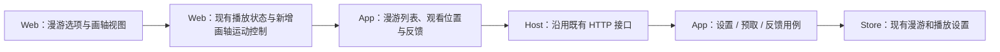
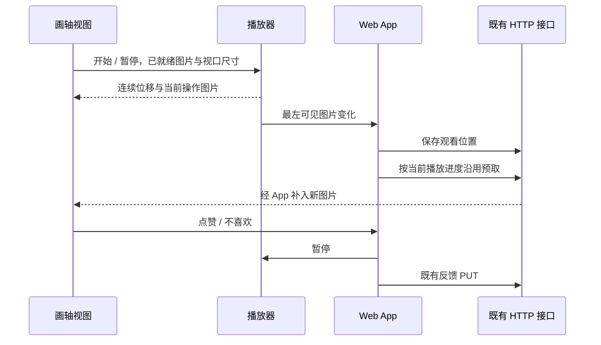

# 漫游画轴播放

## 概述

自动播放增加画轴样式：等高图片保持原比例连续左移，新图从右侧进入，待图时保留最后一张。

## 架构

## 职责边界

| 接口 / 模块 | 变更 |
| --- | --- |
| `GET/PUT /api/settings/roam` | 新增 `playback_style: single / scroll` 和 `scroll_speed: slow / normal / fast`，默认仍为单张；单张沿用已有展示秒数。 |
| Web 播放器 | 复用播放、暂停、离页暂停和点赞暂停意图；画轴负责连续位移、图片就绪及速度，单张保留现有计时逻辑。 |
| Web 漫游视图 | 等高且不改变图片比例，画面中心覆盖的图片承接提示词和键盘反馈；点击任意图片暂停并选中。 |
| 观看位置 | 通过既有 `/api/roam/view` 保留最左侧仍可见图片，避免历史数量清理移除仍在画面中的图片；与当前操作图片分开管理。 |
| 图片、预取和反馈 | 沿用既有图片窗口、图片读取、`/api/roam/ensure` 和反馈 PUT，不建立新的生图路径。 |

## 调用和数据流

## 重点关注

- 在漫游选项与漫游设置内选择播放样式，画轴提供慢、标准、快三档。
- 新图没有生成或读取完成时停住最后可用图片；完成后平滑继续，不循环伪造旧图。
- 暂停、点击和点赞冻结当前位置；已经主动暂停时，新图完成不会自行恢复。
- 左右方向键与上一张 / 下一张按钮共用平滑定位；从当前实际位置开始移动，连续操作平滑重设目标。
- 点赞暂停后，再点下一张或按右键，平滑移向下一张并接回自动播放；手动暂停后的切换保留暂停状态。
- 点赞时高亮对应图片，并在该图角上显示小红心；标记绑定图片，随画轴一起移动。
- 复用现有毛玻璃、信息、锚点、键盘反馈及沉浸模式；动画不更改图片和反馈记录。
- 只保留当前视口及少量相邻图片参与渲染；隐藏页面暂停动画，离开漫游停止播放。
- 设计预览使用本地中性示意图片；开发和验证使用临时数据与模拟生图。

## 实现与验证

已接入漫游页面及沉浸模式，漫游选项和完整设置共用播放方式、移动速度。默认保持单张模式。画轴复用既有图片窗口、反馈、观看位置、预取和事件接口；仅增加两个展示设置。

- 类型检查与隔离构建通过；前端固定检查组 55 项、核心检查组 20 项、设置与观看位置/清理专项 19 项通过。
- 浏览器检查覆盖桌面、390px 手机、沉浸、连续按键、移动中点赞、宽图角标、等待新图、完整设置保存和重载；画轴 4 项、单张回归 3 项通过。
- 额外运行旧漫游测试时有 4 项失败，使用修改前的 Store/App 源码复现了相同失败：3 项设置测试的暂停预期，以及 `test_reference_uses_latest_valid_selected_task_then_cursor_actual_text` 的提示词来源预期。未计入本次通过项。
