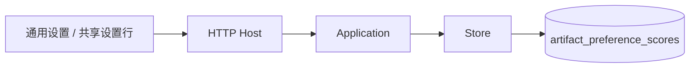
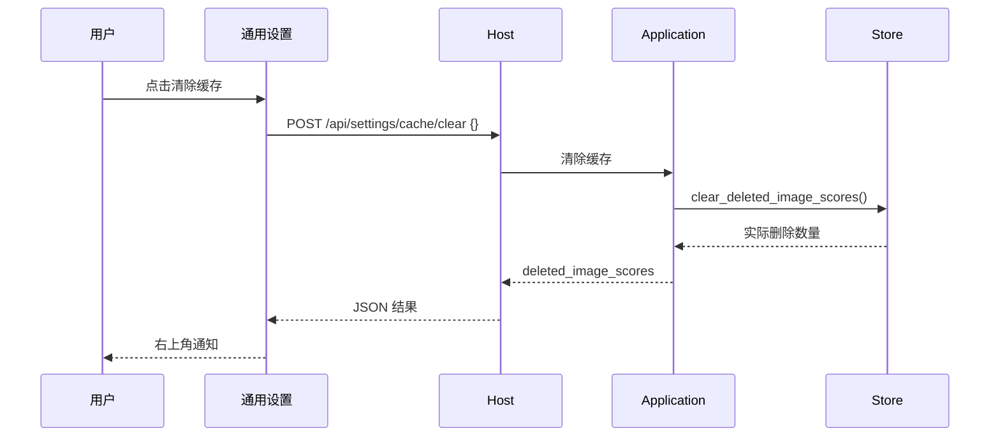

# 设置页清除缓存

## 概述

在「设置 → 通用」增加手动「清除缓存」入口，首版仅清除已删除图片的评分缓存。状态：待确认接口设计。

## 架构

沿用已有前端、HTTP、应用编排和存储职责，不增加清理服务、调度器或清理项注册表。

## 职责边界

| 组成 | 本次变更 |
| --- | --- |
| 通用设置 | 增加「缓存」设置行和「清除缓存」按钮。帮助提示说明当前只清理已删除图片的评分缓存。请求中禁止重复提交，成功和失败复用右上角通知，不改变布局。 |
| Host | 新增 `POST /api/settings/cache/clear`，请求体 `{}`；沿用 JSON、同源限制及错误处理。 |
| Application | 新增清理操作，在线程中调用 Store，返回 `{"deleted_image_scores": 数量}`。 |
| Store | 增加 `clear_deleted_image_scores() -> int`，一次事务删除 `artifact_preference_scores` 中对应 `artifacts.deleted_at IS NOT NULL` 的记录，返回实际删除行数。 |

按钮由用户主动点击，无定时执行，无额外确认弹窗。返回 0 时提示「没有需要清除的缓存」，否则提示「已清除 {count} 条缓存」。后续新增清理种类时再明确范围与接口，不预先设计选项系统。

## 调用和数据流

## 重点关注

- 清理范围以图片已删除标记为准。仅从漫游或生成列表隐藏、但仍保留的图片，其缓存保留。
- 图片、任务、反馈、学习证据、模型参数和标签向量均保留；不执行 `VACUUM`，不宣称释放对应大小的磁盘空间。
- 核对评分写入与图片删除的并发情形，避免晚到的评分结果重新写入已删除图片的缓存。
- 用临时数据库验证删除范围、重复操作、隐藏图片与反馈保留；通过 HTTP 和浏览器验证入口、计数通知、错误及布局稳定性。测试不清理用户实际数据库。
- 更新英文设置指南、设置 API 和存储说明；前端完成类型检查、构建及相关界面验证。
