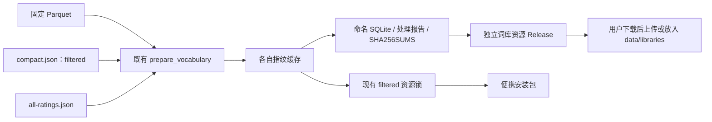
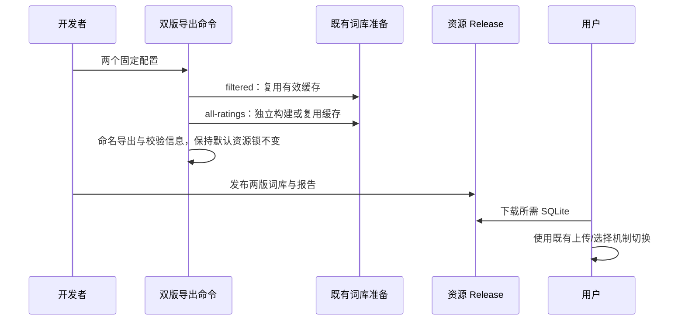

# 双版本词库导出与手动切换

## 概述

提供 `filtered` 与 `all-ratings` 两版可下载词库，安装包默认使用 filtered，用户通过现有词库导入/选择功能手动切换。

## 架构

## 职责边界

- 用户已确认 `filtered` / `all-ratings` 命名及两组参数。保留 `compact.json` 作为 filtered 的配置入口；新增 `all-ratings.json`，两个排除列表均为空，阈值维持 100/1000。
- 新增离线导出命令复用现有准备、指纹与 SQLite，不改变应用接口；输出名称包含版别、对应处理报告与文件校验信息，保持构建用 `corpus/prebuilt.json` 指向 filtered。
- 下载资源与内部构建资源分开：版本化资源 Release 提供两版命名文件及校验信息；发布后保持文件不变。
- 便携构建继续使用 compact 配置和现有 filtered 资源锁；这次在本机重新构建并验证 Windows 包。
- 应用沿用上传或复制到 `data/libraries/` 后刷新选择的现有机制；可并存多版，个人预设与历史保留。

## 调用和数据流

## 重点关注

- filtered 保留 general/sensitive 来源图片；all-ratings 保留全部评级。版别描述来源范围，不保证生成结果的内容。
- 两版仍按 ID 去重并应用词频、共现次数门槛；all-ratings 表示关闭图片/标签排除。
- 保留原始数据、已有缓存和运行词库；下载替换通过选择新文件完成，避免覆盖个人记录。
- 新导出流程不改写默认便携资源锁；发布资产与处理报告均可核对 SHA-256。

## 交付与验证

- 2026-10-19 从固定源数据生成两版；原始文件与已有缓存保留，默认 `corpus/prebuilt.json` 保持 filtered 不变。

| 版本 | 纳入图片数 | 标签数 | 关系数 | SQLite 字节数 |
| --- | ---: | ---: | ---: | ---: |
| filtered | 7,926,661 | 19,456 | 485,591 | 18,518,016 |
| all-ratings | 9,996,042 | 21,542 | 622,439 | 23,498,752 |

- 新增真实 Parquet 小样本冒烟，覆盖两个统计群体、缓存复用、导出校验和、损坏导出拒绝和默认资源锁保持。
- 实际两版导出通过 SHA-256、SQLite 完整性、评级范围、频次门槛和 PMI 抽样检查；隔离 HTTP 实例上传并切换两版，个人预设保留，未提交生图任务。
- 本机 Windows 便携包使用 filtered 重新构建，ZIP 为 69,147,920 字节，隔离启动与默认词库检查通过。MiniLM 使用已校验的本地公开模型完成暖启动验证，权重未打包。
- 导出与包分别保存在根目录 `releases/vocabularies-20261019/`、`releases/filtered-vocabulary-20261019-windows/`，验证材料在 `dev/verification/`。Linux/macOS 本次未运行原生构建。
- 两版下载与切换的当前入口见[词库版本](../../guides/vocabularies.md)。
